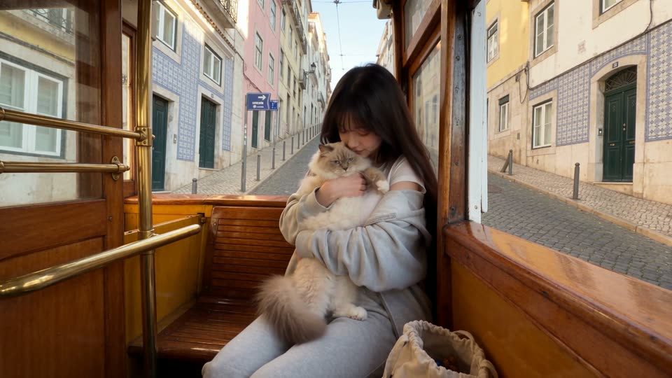

<!-- Generated by scripts/build_readme.py. Edit site.config.json, content/prompts.json, and generator scripts. -->

<a id="case-cms-f34765d0"></a>

# 猫咪乘坐里斯本老电车

[← Back to collection](../../README.md)

**Origin**: `community` · **Task**: `T2V` · **Audio**: `Yes` · **Status**: `Source-linked`

**고양이 × 리스본 트램** A young woman (Image 1 = her face and hair) is already settling into a varnished wooden window seat of a vintage…

<a href="https://awesome.raphael.app/materials/421d2f57-5abc-44ef-8afc-6b31e6e56e70.mp4"></a>

▶ **[Watch audio-enabled MP4](https://awesome.raphael.app/materials/421d2f57-5abc-44ef-8afc-6b31e6e56e70.mp4)**

**Full Prompt**

```text
**고양이 × 리스본 트램**

A young woman (Image 1 = her face and hair) is already settling into a varnished wooden window seat of a vintage yellow Lisbon tram waiting at a hillside stop, steep cobbled street, pastel tiled facades and warm afternoon light outside the open window, brass handrails and polished wood panelling around her, cradling a small fluffy cream-and-grey cat and nuzzling it; once seated she lifts it up to the camera, melting with adoration, and says: "우리 애기에요." A beat later, hard cut to the exact same locked framing: she lowers the cat onto the wooden seat beside her, clips a small harness leash to the armrest, and the tram bell clangs twice as the carriage jolts and starts to creak forward, the cat's ears flick; she turns to it, mouth toward the camera, and coos: "준비됐어?", and the cat answers with a soft meow. Hard cut, same locked framing, now climbing a steep cobbled street: the window is fully open, terracotta rooftops, laundry lines and tiled walls slide past in motion blur, warm wind rushes in whipping her hair and ruffling the cat's fur; one hand on the window frame, the other clutching at her whipping hair, she scrunches her face and yelps half-laughing: "으아, 내 머리!" Hard cut, same locked framing: the tram rattles through a narrow alley, walls close on both sides and the light flickers between shade and sun, she fishes a cat treat from her bag and holds it up, the cat's eyes locking on it with an eager meow, and she says to it with a teasing smile: "간식 줄까?!" Hard cut, same locked framing: the tram slowing at a crest, wheels squealing softly and the carriage rocking at a lazy pace, she props an elbow on the window ledge, jaw on her hand in a loose pose, glances out at the open sky and river view then side-eyes the lens and sighs: "오늘 날씨가 진짜.." At the end, hard cut to arrival, same locked framing: the tram has pulled to a halt at a viewpoint stop, brakes hissing and the street outside stops moving past; she leans toward the camera, warm and playful with the cat on the seat beside her, reaches a hand toward the lens as if to switch off the cam, and says clearly: "도착! 다녀올게요." — her hand grazes the lens and the clip cuts out.

Keep her face and hair exactly as the reference and never copy its background. The vintage yellow tram interior, its wooden seats, brass rails and open window stay identical, the small cream-and-grey cat stays the same in every cut, and the window stays fully open from the third cut on; the first two cuts sit at the hillside stop and the rest happen on the moving tram and at the viewpoint stop.

The camera is one locked viewpoint low on the wooden seat between the woman and the cat, slightly wide-angle, seeing the woman at the window seat and the cat beside her; every cut returns to this exact position and focal length and the camera never moves, pans, tilts, zooms, dollies, drones or reframes — only the woman and the cat move, rhythm coming only from that and hard cuts; no camera, mount, tripod or filming rig is ever visible, no rig reflection or shadow.

Shot like real self-filmed vlog footage in live-action photorealism: true skin texture with pores and fine hairs, film grain, natural light falloff, no beauty filter or skin smoothing, no 3D-render, CGI or AI-plastic gloss, staying razor-sharp through wind and motion. Never render a reference sheet or duplicate a subject. No subtitles, no on-screen text, no logo, no watermark.

Diegetic sound only and absolutely no background music, not even at the end: tram bell clangs, wheels grinding on steel rails, creaking wood, rushing window wind, brake squeal and hiss, distant street murmur, the cat's soft meows and collar bell; her spoken lines are all live and frontal with the lips clearly visible and the mouth matching the words, in Korean, no voiceover.
```

| Parameter | Value |
| --- | --- |
| Model | MAGI-2 (flagship) |
| Task type | t2v |
| Duration / FPS | 30.2s · 25 fps |
| Resolution / Ratio | 1080p · 16:9 |
| Audio mode | mixed (audio=True) |

[Original source](https://x.com/doctorwasif/status/2126304231179309362) · Creator: [@doctorwasif](https://x.com/doctorwasif) · 2026-11-27

> 视频使用 MAGI-2 为作者自述，未经独立核实。X 原视频：https://video.twimg.com/amplify_video/2126304158428876800/vid/avc1/1920x1080/81D3PHu7VRvO_NFF.mp4?tag=29

**[Generate similar on Raphael →](https://raphael.app/ai-video-generator?utm_source=github&utm_medium=repository&utm_campaign=magi_2_launch&utm_content=case_cms-f34765d0&utm_term=en)**
