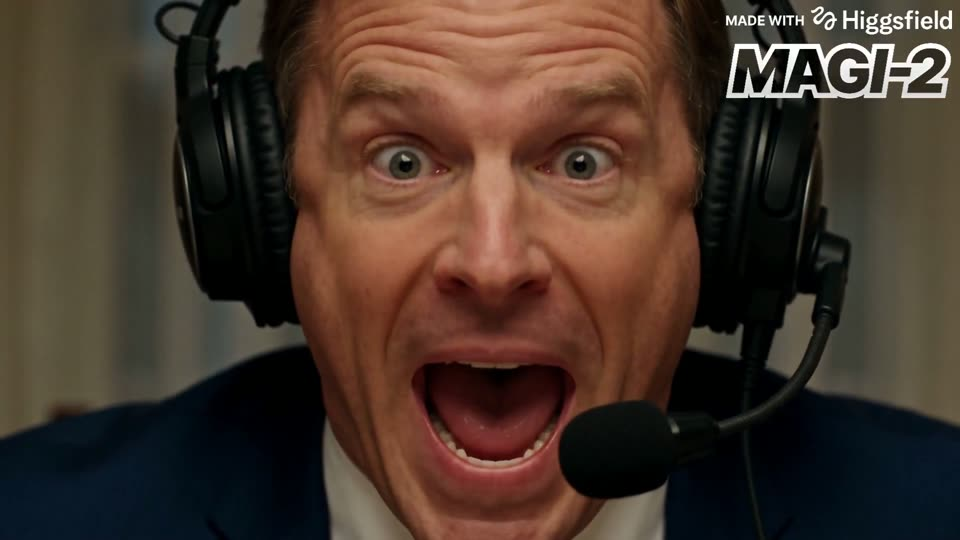

<!-- Generated by scripts/build_readme.py. Edit site.config.json, content/prompts.json, and generator scripts. -->

<a id="case-cms-f7ba0d44"></a>

# 感恩节晚餐体育直播

[← Back to collection](../../README.md)

**Origin**: `community` · **Task**: `T2V` · **Audio**: `Yes` · **Status**: `Source-linked`

20-second absurdist Thanksgiving comedy filmed like a professional live sports broadcast. An original enthusiastic sports commenta…

<a href="https://awesome.raphael.app/materials/da51272a-4353-45c9-a5f7-847568fb7575.mp4"></a>

▶ **[Watch audio-enabled MP4](https://awesome.raphael.app/materials/da51272a-4353-45c9-a5f7-847568fb7575.mp4)**

**Full Prompt**

```text
20-second absurdist Thanksgiving comedy filmed like a professional live sports broadcast. An original enthusiastic sports commentator wearing a navy blazer and a large headset provides dramatic commentary on an ordinary family passing dishes around the Thanksgiving dinner table. The family remains completely oblivious to the seriousness of the coverage.
- 00:00–00:02: Extreme close-up of the commentator shouting, "Here comes the opening pass!"
- 00:02–00:04: Slow-motion tracking shot of a grandmother passing a bowl of mashed potatoes across the table.
- 00:04–00:06: Overhead shot following the bowl's trajectory between two relatives.
- 00:06–00:08: The commentator excitedly announces, "Beautiful technique!"
- 00:08–00:10: Macro shot of a guest catching a sliding breadbasket.
- 00:10–00:12: A young adult reaches dramatically across the table for the gravy.
- 00:12–00:14: Slow-motion replay of the gravy boat being intercepted by another relative.
- 00:14–00:17: Close-up of the commentator shouting, "An incredible interception!"
- 00:17–00:20: Wide reveal of the commentator sitting at the dinner table, talking into a spoon. His wife quietly says, "Please stop."
Maintain consistent family members, table geography, dish trajectories and natural reactions. Authentic sports-broadcast framing, dramatic slow-motion replay and accurate lip-sync. No broadcaster logos or graphics. SFX: cutlery, dishes sliding, energetic commentary and awkward silence. No music.
```

| Parameter | Value |
| --- | --- |
| Model | MAGI-2 (flagship) |
| Task type | t2v |
| Duration / FPS | 20.3s · 30 fps |
| Resolution / Ratio | 1080p · 16:9 |
| Audio mode | mixed (audio=True) |

[Original source](https://x.com/airina_xyz/status/2125907956541849634) · Creator: [@airina_xyz](https://x.com/airina_xyz) · 2026-11-26

> MAGI-2 为作者自述，未经独立核实。

**[Generate similar on Raphael →](https://raphael.app/ai-video-generator?utm_source=github&utm_medium=repository&utm_campaign=magi_2_launch&utm_content=case_cms-f7ba0d44&utm_term=en)**
