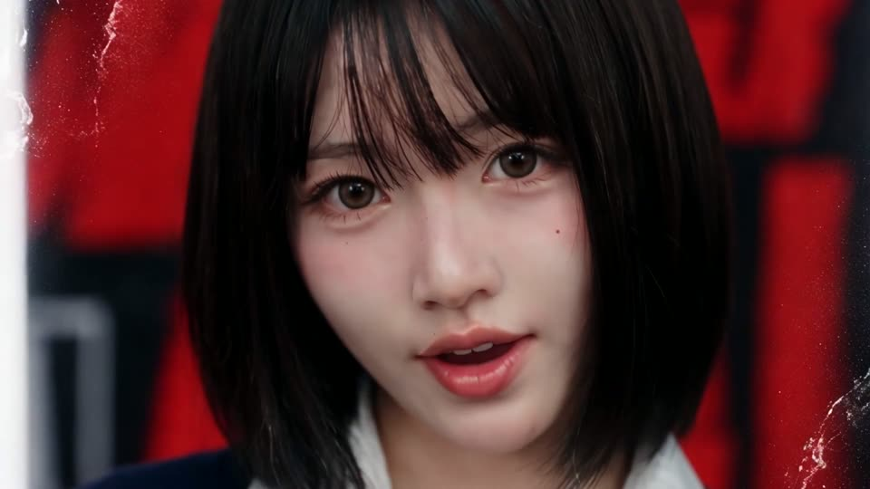

<!-- Generated by scripts/build_readme.py. Edit site.config.json, content/prompts.json, and generator scripts. -->

<a id="case-cms-fa134f7b"></a>

# 三人偶像团的赛博说唱

[← 返回合集](../../README.zh-CN.md)

**来源类型**: `community` · **任务**: `T2V` · **音画**: `Yes` · **状态**: `来源收录`

社区 MAGI-2 视频案例（@poruru_ai）：三人偶像团的赛博说唱。

<a href="https://awesome.raphael.app/materials/8e1c5317-ed6c-4e32-9a04-696581d585d8.mp4"></a>

▶ **[播放有声视频原片](https://awesome.raphael.app/materials/8e1c5317-ed6c-4e32-9a04-696581d585d8.mp4)**

**完整原始提示词**

```text
15-second photoreal cyber-grunge rap music video, 16:9, original three-member idol group performance, all performers adults aged 20+.

Reference mapping in attached order:

Image 1 = Performer A, long straight black hair with parted wispy fringe and red/navy striped tie.

Image 2 = Performer B, very long straight black hair with full fringe and navy/white striped tie.

Image 3 = typography and visual style reference ONLY, not a person.

Image 4 = Performer C, short dark bob with wispy bangs and navy/white striped tie.

Keep each distinct facial identity, hairstyle, navy cardigan, white shirt, striped tie and neat uniform-inspired outfit consistent.

Do not copy the selfie poses or original backgrounds.

No start frame; all four images are references.

Cohesive trio on an original black/red studio stage, white rim lights, moving graphic panels.

Dark-pop cyber-grunge rap editorial energy, photoreal high-fashion polish, late-1990s/early-2000s underground zine collage, scanned magazine textures, coarse grain, halftone, distressed print edges, subtle scan misregistration.

High contrast red/black/white.

Typography inspired by Image 3, including brief readable MAGI-2 / Made with MAGI-2 on @Higgsfield graphic fragments integrated into performance, never a static title card.

Immediate physical movement from first frame, rapid hard cuts every 1.5–3s, no fades or dissolves, no static poses or frozen beauty shots.

Prioritize faces and upper-body close-ups, intercut medium-close trio shots.

Every shot has visible subject and camera motion.

Audio: original energetic rap beat, punchy bass, syncopated drums, crisp female group rap vocals, clear rhythmic lip sync; no existing song or artist imitation.

0–2s:

Rapid extreme close-ups A/B/C, each lifts chin, direct eye contact, sharp head tilt and rhythmic mouth movement, fast handheld push-ins.

2–4s:

Tight three-quarter shots, A turns toward camera with shoulder roll, B steps confidently and adjusts tie, C angles toward camera with shoulder accent; lateral camera track and brief trio shot.

4–6s:

Medium-close trio walks two synchronized strong steps toward camera, one points toward lens, one sweeps hand downward, one accents shoulder; camera dollies backward.

6–8s:

Rotating close-ups A snaps head left then center, B half-turns shoulders, C locks eyes with lens; quick mini-orbit, beat-synced grunge typography.

8–10s:

Tight side profiles, trio strides past camera in staggered rhythm, each looks back toward lens; camera pans and catches glances.

10–12s:

Alternating close-ups, each leans in and raps a punchy line, sharp hand gestures near face, shoulder drops and weight shifts; brief tight trio framing.

12–15s:

Synchronized step forward, sharp head snaps, direct gaze, decisive hand gesture, final powerful group formation with aggressive camera push-in.

Keep motion until final frame.

Natural hair and fabric movement, realistic weight transfer, hand anatomy, neck and shoulder mechanics, natural facial expression and lip sync.

Maintain distinct identities and recurring trio coverage throughout; never duplicate, swap or morph faces.

Stylish kinetic moving underground fashion magazine spread.
```

| 参数 | 配置 |
| --- | --- |
| 模型 | MAGI-2 (flagship) |
| 任务类型 | t2v |
| 时长 / 帧率 | 15.2s · 25 fps |
| 分辨率 / 比例 | 1080p · 16:9 |
| 音频模式 | music (audio=True) |

[原始来源](https://x.com/poruru_ai/status/2125942688122028532) · 作者: [@poruru_ai](https://x.com/poruru_ai) · 2026-11-26

> 模型 MAGI-2 为作者自述，未经独立核实。 仅收录原帖附带的 MAGI-2 视频。

**[在 Raphael 上生成同类视频 →](https://raphael.app/ai-video-generator?utm_source=github&utm_medium=repository&utm_campaign=magi_2_launch&utm_content=case_cms-fa134f7b&utm_term=zh-CN)**
