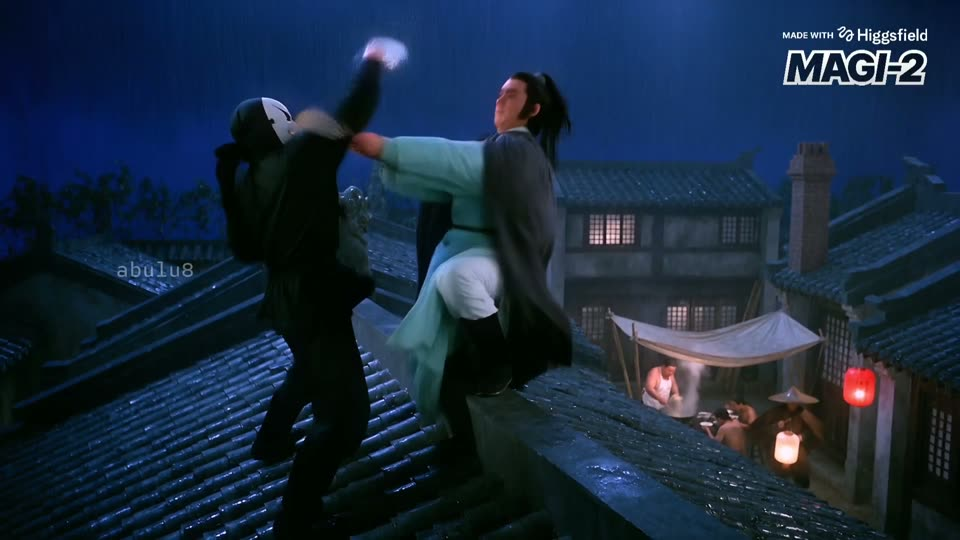

<!-- Generated by scripts/build_readme.py. Edit site.config.json, content/prompts.json, and generator scripts. -->

<a id="case-cms-fb4c34de"></a>

# 雨夜屋顶武侠短片

[← Back to collection](../../README.md)

**Origin**: `community` · **Task**: `T2V` · **Audio**: `Yes` · **Status**: `Source-linked`

Community MAGI-2 video case (@abulu8): 雨夜屋顶武侠短片.

<a href="https://awesome.raphael.app/materials/9c81bb45-bca0-4b76-aabb-3812af843d74.mp4"></a>

▶ **[Watch audio-enabled MP4](https://awesome.raphael.app/materials/9c81bb45-bca0-4b76-aabb-3812af843d74.mp4)**

**Full Prompt**

```text
【全局前置设定：画质与质感】

1970 年代香港武侠电影质感。Techniscope 2.35:1 宽银幕，褪色的 Eastmancolor 胶片色调，厚重的胶片颗粒，轻微的片门抖动与画面边缘暗角，偶尔出现细小的划痕与灰尘斑点。

夜景是那个年代的摄影棚做法：深蓝色滤光的夜色，雨塔浇下的人造大雨，雨丝在逆光中呈亮白色的斜线；巷子里的灯笼与面摊的炉火提供暖橙色的点光源，与冷蓝的夜色形成强烈对比。硬光、强轮廓光，人物脸上有明显的油彩妆感，被雨水打湿后泛着光。

所有特效都是实拍物理效果：吊威亚的腾跃与跨屋顶飞跃、真实碎裂飞溅的瓦片、兵器撞击的火星、溅起的水花。全片绝对没有能量光效、气功光或数字特效。

声音是那个年代的后期配音质感：兵器碰撞声、瓦片碎裂声略微过响、过干净；每一次重击配一记鼓点；哗哗的雨声、巷子里面锅的咕嘟声与紧张急促的古筝配乐从第一帧贯穿到最后一帧。

【沈孤鸿·铁扇书生】

成年东亚男性，约二十八岁，身高 5 英尺 11 寸，身形修长匀称，肩背挺直，比例正常的成年男性体型。黑色长发在脑后束成一束，额前两缕湿发贴着脸颊；剑眉星目，神情沉静。淡青色书生长衫，外罩深灰色薄披风，黑色细腰带，被雨淋透后贴在身上。黑色布靴。

兵器是一把铁骨折扇：十二根乌黑精铁扇骨，扇面白底黑字书法，展开时扇沿锋利。合拢时是一根短棍，展开时是一面扇形的盾。

他冷静、优雅、干净利落。

【鬼面·夜行刺客】

成年东亚男性，身高 6 英尺 1 寸，身形精瘦修长，四肢细长，比例正常的成年男性体型。全身黑色紧身夜行衣，束袖，黑腰带。脸上戴一张白色鬼脸面具：惨白底色，两道上挑的黑色眉眼描线，嘴部一道咧开的红色裂口。面具后露出几缕凌乱的黑发。

兵器是一对钢制双钩：每把钩长约三尺，钩头弯曲如月牙，护手处一片月牙形的刃。

他快、诡、阴，专从刁钻角度勾、拉、劈。

【体型比例·必须严格遵守】

沈孤鸿 5 英尺 11 寸，鬼面 6 英尺 1 寸。鬼面略高、更瘦长。全程严格保持。

【人体与兵器完整性·防变形·必须严格遵守】

画面中每个人始终是两条手臂、两条腿、一个头，每只手五根手指，关节只在正常的方向弯曲。

所有人的面孔在任何速度、任何角度下都保持稳定，五官不得拉伸、融化、错位或互换。鬼面的面具始终是一张完整的硬质面具，形状与图案不得变形，直到 27 秒被劈开。

兵器是刚性的：折扇的十二根扇骨始终笔直、数量不变；双钩始终是两把，钩身不得弯曲、拉长、融化或变成别的形状。兵器始终握在手里，不得与手掌融合、不得穿过身体。

两名打斗者的肢体不得缠绕在一起。每一次接触都是清晰的一击——出手、接触、分开，两个身体的轮廓在每一帧都清楚可辨。

每个动作是一道干净的单一弧线，有明确的起点与终点。快，但每一帧都是一个完整、清晰、结构正确的身体。

【场景：雨夜古镇屋顶】

一座古镇的屋顶群，夜晚，大雨。

层层叠叠的深灰色瓦片屋顶，坡度陡峭，雨水顺着瓦槽流下，屋檐边缘挂着水帘。屋脊上有翘起的檐角与陶制脊兽。屋顶之间有窄窄的巷子间隙。几处屋顶上立着砖砌烟囱。两座屋顶之间横拉着一根粗麻绳，挂着一排被雨淋湿的布幡。屋顶下方是狭窄的石板巷子，挂着红色纸灯笼，灯光从下方照上来，在湿瓦上反出一片片橙光。屋顶群的尽头是一座三层木结构钟楼，顶层挂着一口巨大的铜钟。

【可破坏结构】瓦片、脊兽、檐角、烟囱、麻绳与布幡、钟楼木栏——全部可以被踩碎、劈飞、割断、撞穿。被踩碎的瓦片会滑落掉进巷子里。已损坏处永久保持。

【刚性空间锚点】屋顶群的排列、两屋之间的麻绳、钟楼的位置、巷子里的灯笼与面摊，全片绝不漂移、消失或改变数量。

【环境中的人·背景层·必须严格遵守】

屋顶下方的巷子与周围的窗户里有几个过夜生活的镇上百姓，他们只存在于背景与中景，是环境的一部分：

巷子里，一个面摊撑着油布雨棚，矮胖的老板系着白围裙在热气腾腾的锅前用长筷子捞面，两个穿粗布短衫的客人坐在矮凳上端碗吃面；一个瘦小的打更人戴斗笠、披蓑衣，提着灯笼、敲着竹梆子在巷子里走着；对面二楼一扇木格窗里亮着灯，一个白发老妇人坐在窗边纳鞋底。

他们一开始各做各的事。随着瓦片从屋顶滑落砸进巷子、打斗声越来越响，他们陆续抬头往上看，反应写在下方的时间段里。

人数固定：面摊老板一人、吃面客人两人、打更人一人、窗边老妇人一人，共五人，全片绝不增减。

他们全程待在巷子里与窗户后，绝不上屋顶、绝不靠近两名打斗者、绝不加入打斗、绝不被兵器碰到。他们在画面中始终比打斗者小、离镜头更远，只在广角与俯拍镜头中出现，不给单独的特写。

【全片从第一帧到最后一帧都是恶斗·必须严格遵守】

第 0 帧已经在打。没有开场对峙、没有亮相。

第 0 秒到第 30 秒，攻防与追逐一刻不停，任何一秒都不允许出现没有攻防或没有高速移动的画面。背景百姓的反应只在打斗的同一画面中发生，绝不打断打斗。最后一帧依然处在高速运动中。

绝对禁止：对峙、凝视、站着不动、单独的表情镜头、僵持、蓄力、摆架势、慢动作、停顿、结尾的静止画面、定格。

变焦急推只作为 0.3 秒的插入，插完立刻回到打斗。

【屋顶的物理】湿瓦是滑的：急停与落脚时脚下有真实的打滑、瓦片碎裂、碎瓦顺坡滑落、水花溅起。每次跨越屋顶间隙都是一次真实的腾空飞跃，有起跳、滞空与落地冲击。扇子展开时扇开一片雨幕；双钩挥过时甩出一道水线；兵器相撞的火星在雨中溅开即灭。

【密度】全片每秒 4—6 次清晰的攻防或追逐状态变化，下方每段写明了交击次数，必须全部打出来。速度快，但不是快进，不用模糊残影掩盖动作。

【伤害等级 0】无血、无伤口。凶狠体现为：衣衫被钩破、兵器撞出火星、瓦片被踩碎、被震退滑行、险些滑下屋顶。

【胜负】沈孤鸿赢：鬼面的双钩被打落，面具被劈成两半。

【对白规则】本片没有任何台词、对白、旁白或内心独白。所有文字都是画面说明，绝对不得念出、不得配音。

【运镜·七十年代武侠语法】

不使用现代手持晃动与 FPV。使用：沿屋脊方向的横移跟拍；跨越间隙时的低角度仰拍；从高处俯拍屋顶群与巷子，交代位置与间隙；0.3 秒变焦急推插入。

近景与广角交替：每一段贴身快打之后立即切回广角，让观众看清两人在哪个屋顶、离边缘多远、下方巷子里的百姓在做什么。

━━━━━━━━━━━━━━━━━━

【0.0—3.0 秒｜开打·八次交击】

第 0 帧：固定低角度广角，雨夜屋顶，鬼面的双钩正从左右两侧勾向沈孤鸿的脖子——沈孤鸿"啪"地展开铁扇一挡，两只钩头同时撞在扇骨上，火星在雨中溅开即灭。

紧接着：沈孤鸿合扇点向鬼面手腕，鬼面撤钩；鬼面左钩低扫脚踝，沈孤鸿抬脚，钩子刮碎一片瓦；右钩上撩，沈孤鸿仰身，钩尖擦过他的下巴前方；沈孤鸿合扇横砸鬼面的肩头，鬼面侧身卸开；鬼面双钩剪向他的腰，沈孤鸿展扇下压，压住双钩，借力后翻，落在屋脊上。

画面下方的巷子里，面摊老板正在捞面，打更人敲着梆子慢慢走过，谁都没有抬头。

每一次碰撞配一记鼓点。

【3.0—6.0 秒｜屋脊·九次交击】

横移跟拍，沿屋脊方向。

两人在窄窄的屋脊上快打：鬼面左钩劈、右钩勾、左钩拉，沈孤鸿扇子开合连挡三下；鬼面一钩勾住扇沿往外拉，沈孤鸿顺势转身把钩带偏，两人分开；鬼面一脚踹来，沈孤鸿侧身让过，鬼面的脚踩碎一只陶脊兽，碎片滚下屋坡；沈孤鸿合扇连点鬼面胸口两下，鬼面连退两步，脚下打滑往屋坡下滑去——他把一只钩子勾在屋脊上稳住，翻身冲回屋脊。

俯拍可见：脊兽的碎片掉进巷子，砸在面摊的油布雨棚上弹开。面摊老板举着长筷子抬头往上看，两个吃面的客人端着碗跟着抬头。

【6.0—9.0 秒｜飞越巷子·七次交击】

鬼面一钩横扫，沈孤鸿向后一跃——腾空跳过一条巷子的间隙，落在对面的屋顶上，脚下一滑，瓦片碎了一片。

低角度仰拍，背景是雨夜天空：鬼面紧跟着腾空飞越巷子，双钩高举在空中劈下——沈孤鸿展扇上挡，钩刃撞在扇骨上，一串火星；鬼面落地即连攻：左钩、右钩、扫腿——沈孤鸿连格两下，跳起躲过扫腿；在空中一扇拍在鬼面的面具上，"当"的一声，鬼面的头被拍得偏向一侧，面具完好。

两人在空中飞越巷子时，下方的打更人停下脚步，仰起斗笠，手里的梆子停在半空。

【9.0—12.0 秒｜麻绳·七次交击】

两人追打到横在两屋之间的麻绳旁。

沈孤鸿跳上麻绳，在摇晃的绳子上向前奔跑，脚下布幡乱甩；鬼面追到绳边挥钩连砍两下，沈孤鸿在绳上左右跳躲；鬼面一钩割断一条布幡，布幡在雨中飘落，落向对面的木格窗；鬼面第四钩割断了麻绳——

绳子断开的瞬间，沈孤鸿抓住断绳的一头荡了出去，在空中划过一道弧，双脚蹬中鬼面的胸口，鬼面倒飞出去，背部撞上一根砖砌烟囱，烟囱顶端的砖块崩落了几块。

背景中，飘落的布幡擦过对面那扇亮灯的窗户，窗边的老妇人放下鞋底，推开窗探出头来。

【12.0—15.0 秒｜连钩·九次交击】

切回广角交代位置，再进入近景。

鬼面从烟囱前弹起，把双钩的钩尾"咔"地扣在一起，连成一把两头带钩的长兵器，在身前抡成一个圆。

近景快打：长钩左头横扫，沈孤鸿展扇挡；右头回扫，合扇格；长钩当头劈下，沈孤鸿侧身让过，长钩劈碎一大片瓦；鬼面抡钩扫下盘，沈孤鸿跳起；落地时一扇横削，鬼面竖钩挡住；两人分开半步，鬼面长钩直捅，沈孤鸿侧身，扇骨顺着钩杆滑下去，敲在鬼面的手指上，鬼面手一松，长钩脱手又被他另一只手抓回。

【15.0—18.0 秒｜险境·八次交击】

固定广角：鬼面抡着长钩连扫，把沈孤鸿一步步逼向屋檐边缘，正好在面摊的正上方。

沈孤鸿退一步挡一下：挡、挡、挡——第四步，他的脚后跟已经踩在屋檐最边上，碎瓦从他脚边滑落，掉进下面的巷子，砸在面摊旁的灯笼上，灯笼剧烈晃荡。两个吃面的客人吓得同时从矮凳上站起来往后缩，面摊老板护着锅往后退。

鬼面长钩全力横扫——沈孤鸿向后一仰，整个上半身探出屋檐之外，长钩从他胸口上方掠过；他借这一仰的势，单脚勾住屋檐翻转一圈，翻回屋顶上，落在鬼面身侧，一扇拍在鬼面的手肘上，鬼面的长钩扫了个空。

【18.0—21.0 秒｜拆钩·八次交击】

近景：沈孤鸿展开铁扇，扇骨卡进双钩相扣的连接处，用力一拧——"咔"的一声，扣子松开，长钩重新分成两把双钩。

鬼面左右手各抓一把，从两侧同时攻来：左钩劈——沈孤鸿合扇格；右钩勾——他展扇挡；双钩同时剪——他后跃；鬼面追上来又是三钩连环，沈孤鸿连闪三下，最后一闪时他已经跳上了通往钟楼的屋顶。

【21.0—24.0 秒｜钟楼·七次交击】

横移跟拍。两人沿着屋顶一路追打到钟楼。

沈孤鸿踩着屋檐纵身一跃，抓住钟楼二层的木栏翻了上去；鬼面紧随其后翻上来。两人在钟楼顶层的木栏边快打：鬼面右钩劈下，沈孤鸿侧身，钩子劈断一截木栏，木头掉进雨里；鬼面左钩横扫，沈孤鸿弯腰，钩子"当"地一声刮在大铜钟上，铜钟嗡嗡长鸣；沈孤鸿合扇连点鬼面左手腕两下，左钩脱手，旋转着飞出钟楼。

俯拍可见：左钩翻转着坠进下方的巷子，"哆"地钉在打更人脚前一步远的石板缝里。打更人吓得一屁股坐在地上，梆子和灯笼都掉了。

【24.0—27.0 秒｜破面·七次交击】

鬼面只剩一把右钩，嘶吼着全力劈下。

沈孤鸿展扇向上一托，接住钩刃，顺势一转扇面把钩子绞开；鬼面空出右手，转身一脚踹来，沈孤鸿侧身，那一脚踹在铜钟上，铜钟又是一声巨响；沈孤鸿合扇敲在鬼面的右手腕上，右钩也脱手，钉进钟楼的木柱里；鬼面空手扑来，沈孤鸿展扇——

扇沿从鬼面的面具正中竖着划过。

【27.0—30.0 秒｜收尾·仍在运动中】

0.3 秒变焦急推插入：白色鬼脸面具沿着正中一道细线裂开。

面具分成左右两半，从鬼面脸上滑落，翻转着飘向下方的巷子——露出面具后一张惊愕的、被雨水打湿的普通男人的脸。他捂着脸踉跄后退，脚下一滑，从钟楼的栏杆缺口处摔了出去，落在下方一座屋顶上，顺着湿瓦一路滑下去，跌进面摊旁边的一堆竹筐里，竹筐四散滚开。

面摊的两个客人跳起来端着碗闪到一边；面摊老板举着长筷子目瞪口呆；对面窗边的老妇人捂住了嘴；坐在地上的打更人张大嘴仰头看着。

沈孤鸿已经从钟楼上纵身跃下，在雨中飞越屋顶，一边飞跃一边"啪"地合上铁扇。

最后一帧依然在运动中：沈孤鸿在大雨中凌空跃过面摊上方的巷子，披风在身后展开；两半白色面具在雨中翻转下坠；铜钟还在摇晃长鸣；下方巷子里的竹筐还在滚动，面摊的蒸汽还在升腾，几个百姓仰着头看着他飞过。横移跟拍随着他的飞跃持续移动，画面在运动中结束。

━━━━━━━━━━━━━━━━━━

【全局约束】

masterpiece, highest quality，1970 年代香港武侠片质感。

两名打斗者：沈孤鸿始终是淡青长衫深灰披风束发；鬼面始终是黑色夜行衣，白色鬼脸面具在 27 秒前全程戴着。

背景百姓始终是五人：面摊老板、两名吃面客人、打更人、窗边老妇人。他们全程只在巷子与窗户里，绝不上屋顶、绝不靠近打斗者。

兵器只有一把铁扇与一对双钩。双钩在 12—18 秒相扣为长兵器，18 秒被拆开；左钩在 23 秒飞落巷子钉在石板上，右钩在 26 秒钉入木柱。

所有人物的面孔、肢体与兵器全程结构稳定，绝不变形。

破坏只能单向累积，必须由实际接触触发。体型差全程保持。

全片 30 秒无任何静止时刻，最后一帧处于运动中。

【负面提示词】

面部变形，面部融化，五官错位，五官拉伸，换脸，脸部抖动，表情扭曲失真，面具变形，面具图案改变，面具提前破裂，面具消失；

肢体变形，肢体扭曲，多手，多腿，多指，少指，关节反向弯曲，肢体缠绕在一起，两个身体融合，身体穿模，手臂穿过身体，人体比例异常，身体拉长，躯干扭曲；

兵器变形，扇骨弯曲，扇骨数量变化，双钩弯曲，双钩拉长，双钩融化，兵器与手掌融合，兵器穿过身体，兵器凭空出现或消失，兵器复制，出现第三把钩；

背景人物数量变化，背景人物复制，路人上屋顶，路人靠近打斗者，路人加入打斗，路人被打到，路人被钩子击中，路人特写，路人面部变形，路人与环境融合，人群拥挤，出现第六个百姓；

画面闪烁，帧间抖动，形体在帧间漂移，人物在帧间变换形状，模糊残影掩盖动作，快进感，跳帧加速；

开场对峙，亮相，对视，凝视，站着不动，单独的表情镜头，变焦急推超过 0.3 秒，僵持，蓄力，摆架势，停顿，节奏缓慢，打斗中断，一招一停，互相等待，全片慢动作，结尾静止，定格帧，最后一帧静止；

能量光效，气功光，发光武器，数字特效，CGI 质感，粒子特效；

现代数字摄影质感，饱和鲜艳的现代调色，手持晃动，FPV 运动，无人机镜头；

流血，伤口，死亡；

台词，对白，旁白，字幕，人名字幕，Logo，水印；

体型差消失，沈孤鸿比鬼面高；

雨停，白天，晴天，屋顶消失，钟楼消失，面摊消失，现代建筑，室内场景，破坏复原；

硬切成黑屏，镜头瞬移，人物出画，低清晰度，卡顿，卡通渲染，动漫风格，3D 渲染。
```

| Parameter | Value |
| --- | --- |
| Model | MAGI-2 (flagship) |
| Task type | t2v |
| Duration / FPS | 30.3s · 30 fps |
| Resolution / Ratio | 1080p · 16:9 |
| Audio mode | music (audio=True) |

[Original source](https://x.com/abulu8/status/2125950604694667400) · Creator: [@abulu8](https://x.com/abulu8) · 2026-11-26

> 作者在 X 原帖中称使用 MAGI-2，模型未经独立核实。

**[Generate similar on Raphael →](https://raphael.app/ai-video-generator?utm_source=github&utm_medium=repository&utm_campaign=magi_2_launch&utm_content=case_cms-fb4c34de&utm_term=en)**
