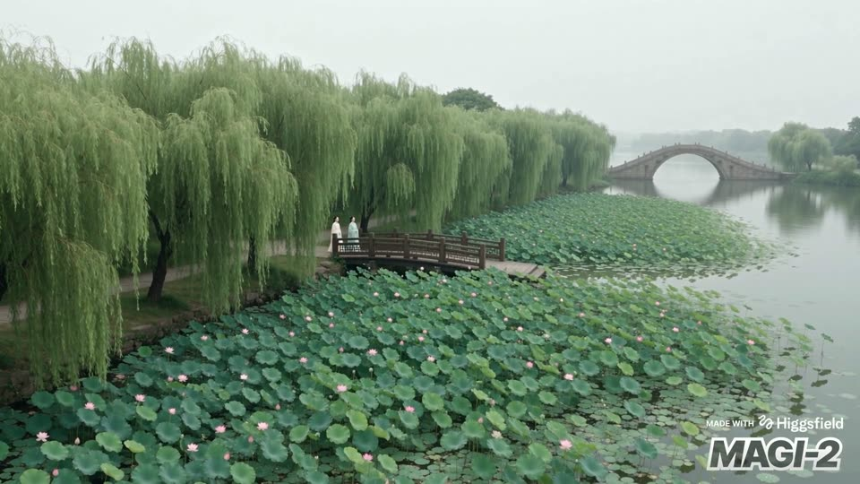

<!-- Generated by scripts/build_readme.py. Edit site.config.json, content/prompts.json, and generator scripts. -->

<a id="case-cms-fbd168f7"></a>

# 两位宋代女子闲游汴河

[← 返回合集](../../README.zh-CN.md)

**来源类型**: `community` · **任务**: `T2V` · **音画**: `Yes` · **状态**: `来源收录`

社区 MAGI-2 视频案例（@PixelAigc）：两位宋代女子闲游汴河。

<a href="https://awesome.raphael.app/materials/bbab4e06-f997-4900-bb25-efedca0abb18.mp4"></a>

▶ **[播放有声视频原片](https://awesome.raphael.app/materials/bbab4e06-f997-4900-bb25-efedca0abb18.mp4)**

**完整原始提示词**

```text
总基调：宋式美学，低饱和青灰、月白、浅赭、茶褐、荷青、柳绿，大量留白构图，温润含蓄。场景连贯：荷塘柳岸、汴河画舫、清明上河图风格汴河市井，连片荷叶荷花、垂柳垂拂，拱桥、酒肆、茶幡、摊贩、行舟、往来行人，繁华但不喧嚣。两位宋代女子形象全程统一，服饰素雅、淡妆，气质松弛从容，对话简短克制，是好友随性闲游。镜头包含航拍、俯拍、环绕、快速横移、镜头对切，快慢节奏搭配，意境清雅，无字幕无水印，口型对齐。 人物： 女子 A：月白襦裙，低梳垂鬟，素玉簪，沉静温婉 女子 B：浅青褙子，素雅发髻，细银钗，灵动松弛
00:00-00:04｜镜头 1｜航拍大场景｜慢推 航拍俯瞰汴河水岸，满池荷花荷叶，垂柳依依，远处拱桥隐约，二人沿着柳荫缓步走向荷塘木桥。镜头缓慢推进。 B：荷开得正好。 音效：微风拂柳、水波轻响、远处橹声
00:04-00:07｜镜头 2｜双人中景｜快速横移 木桥上，A 扶栏杆望湖面，B 把素面团扇递给 A。镜头从荷叶快速横移至二人面部。 A：风很舒服。 音效：扇面轻响、衣料摩擦声
00:07-00:10｜镜头 3｜俯拍｜缓慢下移 俯拍桥面与荷塘，二人并肩凭栏，B 抬手指向汴河方向。镜头缓缓向下。 （无台词，安静观景） 音效：水波汩汩声

00:10-00:13｜镜头 4｜特写｜快速跟随 镜头低贴水面，跟着摇曳的荷花快速划过，A 浅浅含笑。 （无台词） 音效：花叶轻擦水面声
00:13-00:17｜镜头 5｜全景｜环绕 二人坐入画舫，A 在案前备茶，B 撩开竹帘，窗外荷塘垂柳缓缓后退，镜头围绕画舫平稳环绕。 B：前面便是街市了。 音效：船桨划水声、茶盏轻碰
00:17-00:21｜镜头 6｜大场景｜较快前推 画舫驶入汴河主河道，铺开清明上河图式河岸街景，酒旗招展、摊贩林立、行人舟船穿梭。二人探身望向岸边。 （无台词，静静观赏烟火） 音效：轻柔市井人声、叫卖底音
00:21-00:25｜镜头 7｜中近景｜双人对切 二人登岸慢行于街市，B 抬眼看向 A，镜头在两人之间对切。 A：我们去桥上看看。 音效：布幌飘动、行人脚步声

00:25-00:30｜镜头 8｜远景航拍｜慢镜拉高后拉 二人立于拱桥顶端，脚下汴河街市，一侧垂柳荷塘绵延远方，二人相视浅笑。航拍慢慢拉高后拉，宋画全景收尾。 （无台词） 音效：古琴箫声缓缓升起，市井声慢慢淡去
硬性约束：低饱和色调，拒绝浓艳花哨；街景还原北宋质感，繁而不乱；人物脸型、服饰全程稳定统一；镜头快慢交错，兼顾宏大航拍场景与细腻情绪，整体氛围松弛随性，是自在优雅的宋人闲游，台词少而淡，留白多。
```

| 参数 | 配置 |
| --- | --- |
| 模型 | MAGI-2 (flagship) |
| 任务类型 | t2v |
| 时长 / 帧率 | 30.2s · 25 fps |
| 分辨率 / 比例 | 1080p · 16:9 |
| 音频模式 | mixed (audio=True) |

[原始来源](https://x.com/PixelAigc/status/2125940739293216834) · 作者: [@PixelAigc](https://x.com/PixelAigc) · 2026-11-26

> 模型 MAGI-2 为作者自述，未经独立核实。 提示词来自同一作者的原帖回复 https://x.com/PixelAigc/status/2125940742518681943

**[在 Raphael 上生成同类视频 →](https://raphael.app/ai-video-generator?utm_source=github&utm_medium=repository&utm_campaign=magi_2_launch&utm_content=case_cms-fbd168f7&utm_term=zh-CN)**
