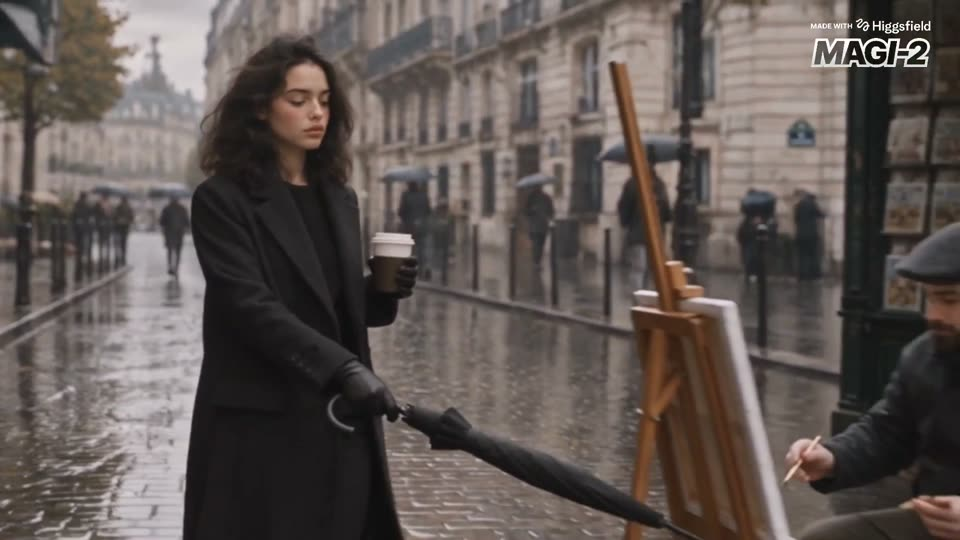

<!-- Generated by scripts/build_readme.py. Edit site.config.json, content/prompts.json, and generator scripts. -->

<a id="case-cms-fdda6fe4"></a>

# 雨中巴黎的冷面喜剧

[← 返回合集](../../README.zh-CN.md)

**来源类型**: `community` · **任务**: `OMNI-REF` · **音画**: `Yes` · **状态**: `来源收录`

社区 MAGI-2 视频案例（@Ciri_ai）：雨中巴黎的冷面喜剧。

<a href="https://awesome.raphael.app/materials/6b1fee73-b1e4-4c82-9a5a-18cdda5c2128.mp4"></a>

▶ **[播放有声视频原片](https://awesome.raphael.app/materials/6b1fee73-b1e4-4c82-9a5a-18cdda5c2128.mp4)**

**完整原始提示词**

```text
THE GENTLEWOMAN 02 — THE ART OF NOT CARING. CLIP 2: THE CITY BOWS DOWN. Create the second 15-second cinematic deadpan physical-comedy sequence in the same rainy Paris morning, visually continuous with clip 1. Use the character-sheet image as the strict identity, face, hair, wardrobe and prop reference; same woman, same charcoal-black long coat, dark outfit and boots. Coffee cup stays in her LEFT hand; CLOSED matte-black umbrella stays in her RIGHT hand at all times and never opens. In five elegant, fast, readable vignettes: 1) she rescues a street artist's easel from tipping by nudging its support back into place with the closed umbrella; 2) a paper bag of birdseed slips, scattering pigeons; she calmly rights the bag and guides it back to the owner; 3) a waiter struggles with a wobbling silver serving tray; she catches and steadies the edge using the umbrella handle without taking the tray; 4) at a grand Paris hotel entrance, a suitcase wheel is stuck in a cobblestone gap; she uses the umbrella tip to free it with one precise movement; 5) close-up as she continues walking, finally allowing the faintest satisfied smile, then returns to her perfectly neutral expression. Finish with a doorman giving her a small respectful nod as she passes. Understated visual comedy, believable physics, soft overcast light, wet reflective Paris streets, refined European fashion-film cinematography, smooth tracking and clean cuts. No dialogue, no captions, no text, no hand switching, no umbrella opening, no extra props in her hands.
```

| 参数 | 配置 |
| --- | --- |
| 模型 | MAGI-2 (flagship) |
| 任务类型 | omni-ref |
| 时长 / 帧率 | 22.6s · 30 fps |
| 分辨率 / 比例 | 1080p · 16:9 |
| 音频模式 | mixed (audio=True) |

[原始来源](https://x.com/Ciri_ai/status/2125795679201304780) · 作者: [@Ciri_ai](https://x.com/Ciri_ai) · 2026-11-26

> 作者自述使用 MAGI-2，未经独立核实。

**[在 Raphael 上生成同类视频 →](https://raphael.app/ai-video-generator?utm_source=github&utm_medium=repository&utm_campaign=magi_2_launch&utm_content=case_cms-fdda6fe4&utm_term=zh-CN)**
