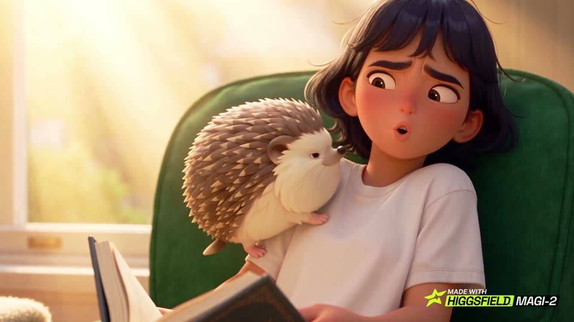

<!-- Generated by scripts/build_readme.py. Edit site.config.json, content/prompts.json, and generator scripts. -->

<a id="case-hedgehog-pip-3d-comedy"></a>

# Maya & Pip the Hedgehog — 3D Animated Short

[← Back to collection](../../README.md)

**Origin**: `community` · **Task**: `OMNI-REF` · **Audio**: `Yes` · **Status**: `Source-linked`

30-second 1440p 3D animated comedy anchored by two character reference sheets, featuring American English dialogue, hedgehog SFX, and a 14s match cut.

<a href="https://awesome.raphael.app/materials/60bfd130-6d8c-477d-b2d3-72839e63c7e6.mp4"></a>

▶ **[Watch audio-enabled MP4](https://awesome.raphael.app/materials/60bfd130-6d8c-477d-b2d3-72839e63c7e6.mp4)**

**Full Prompt**

```text
30-second 3D animated slice-of-life comedy, 16:9, one pass with natural shot changes and exactly one match cut at 14s. Only Maya and Pip appear. No on-screen text, subtitles, captions, labels, logos or watermarks.

STYLE (every frame): premium feature-animation 3D with warm family-film appeal; soft global illumination, subsurface skin, dense groomed quills and face fur, tactile fabric folds, gentle depth of field. Mostly medium shots and medium close-ups from a diagonal front angle so both faces, hands, tiny feet and contact points stay readable. 
Cushions and fabric compress under weight. Sensation effects are stylized cartoon overlays kept clear of eyes and mouths; nothing burns, tears or breaks. Pip's eyes lead, then head; ears, lids and weight respond together. Comfort eye-closing only after real contact. Maya's emotions show in brows, eyes, mouth and shoulders at once.
CAST:

@[Image 1](image_1) is Maya — wavy black bob with bangs, light-tan skin; white T-shirt, then the sheet's cream wool sweater after the cut. Full-preserve face, hair, build and outfit. Do not take the charcoal backdrop, panel layout or isolated studies.

@[Image 1](image_1) is Pip — round hedgehog, brown-and-cream banded quills, cream face, black bead eyes. Full-preserve face, body mass, coloring and eye color. Do not take the cream backdrop or multi-view layout. Exactly one hedgehog.

SET: one cozy living room, deep green velvet armchair, small wooden side table with a folded fleece blanket and a bowl of blueberries, tall window behind the chair. Pip on screen left, Maya in the armchair right of center; layout never changes.

PALETTE: before the cut — bright sunny afternoon, warm yellow light, Maya in a thin white T-shirt. After the cut — rainy autumn evening, amber lamp glow, rain streaks on the window.

STORY: Maya keeps dodging Pip's pointy cuddles, until an unreachable sweater itch makes his quills the perfect back-scratcher.

0-5s | Sunny afternoon. Maya reads in the armchair in her white T-shirt. Pip climbs up her arm and snuggles against her neck. At contact tiny pink cartoon starbursts pop where the quills touch. Maya jolts, eyes wide, shoulders hunched, teeth clenched: {Ow! Pip, you're so pointy!} Pip looks up, nose twitching happily, and presses closer. <hedgehog snuffles, tiny boing at contact> (pizzicato strings, ukulele)

5-11s | Maya sets him on her lap and leans away; the starbursts fade. Pip notices the gap, trots after her and presses close; starbursts again. Wider shot: he follows again until she is tipped over the armrest, one hand held out flat: {Pip, personal space, please!} Pip pushes his soft nose into her palm; she grimaces but strokes his soft forehead with one fingertip. <chair creaks; music pauses before the line>

11-14s | Maya cups him with both hands under his belly and sets him on the fleece blanket on the side table, then offers him a blueberry from the bowl. Pip nibbles it, then looks at her, head tilted, puzzled. Maya sighs, then slides the whole bowl closer to him with a rueful smile. (score softens)

14-19s | Match cut, same composition: rainy evening. Maya now wears the chunky wool sweater. Wiggly yellow cartoon itch squiggles crawl between her shoulder blades. She twists and reaches over her shoulder, can't reach, rubs against the chair back, grimacing. Then she notices Pip on the side table. Eyes light up; she pats her shoulder eagerly: {Pip! Come here, buddy!} <rain on glass, wool rustle, bright xylophone note>

19-23s | Medium close two-shot. Pip turns toward her, looks at her face, then at her shoulder, lifts his chin and half-closes his eyes smugly for half a second. Maya grins pleadingly and holds out a cupped palm. Pip walks onto it; she supports his belly, leans forward and gently sets him on her sweater between her shoulder blades. (plucked phrase, then gentle piano)

23-30s | Pip shuffles side to side; his quills rake the wool, and each itch squiggle pops into warm sparkles. Maya's shoulders drop, eyes close, long sigh: {Oh, that's the spot.} Pip pauses and starts to climb down; her eyes open and she steadies him with a palm: {Don't stop now.} A brief smug look, then Pip scratches in little circles again. Maya laughs softly; Pip ends curled on her shoulder as she strokes his face. <contented hedgehog huffs> (warm cello and piano ending)

AUDIO: Dialogue language: natural American English, spoken only by Maya, mouth visible and lip-synced; complaints are exasperated, never flat. Pip makes only natural hedgehog sounds. Lyric-free score under dialogue: pizzicato and ukulele before the cut, rain ambience then warm cello and piano after. No laugh track, no narration.

NEGATIVE: no text or subtitles, no extra people or animals, no human speech from Pip, no clothing or accessories on Pip, no extra limbs or tails, no clipping, no floating, no props appearing from nowhere, no scorch or smoke.
```

| Parameter | Value |
| --- | --- |
| Model | MAGI-2 (flagship) |
| Task type | omni-ref |
| Duration / FPS | 30.2s · 25 fps |
| Resolution / Ratio | 1440p · 16:9 |
| Audio mode | mixed (audio=True) |

**Omni-References**

1. `image` · [Character reference sheet 1 (creator post)](https://pbs.twimg.com/media/HYACs_OXEAAsxmq.jpg?name=orig)
2. `image` · [Character reference sheet 2 (creator post)](https://pbs.twimg.com/media/HYACuJZWcAAHmAl.jpg?name=orig)

[Original source](https://x.com/Dheepanratnam/status/2125701889702457524) · Creator: [@Dheepanratnam](https://x.com/Dheepanratnam) · 2026-11-25

> Creator reported MAGI-2 via Higgsfield with two character reference images; prompt posted at https://x.com/Dheepanratnam/status/2125702385561424127.

**[Generate similar on Raphael →](https://raphael.app/ai-video-generator?utm_source=github&utm_medium=repository&utm_campaign=magi_2_launch&utm_content=case_hedgehog-pip-3d-comedy&utm_term=en)**
