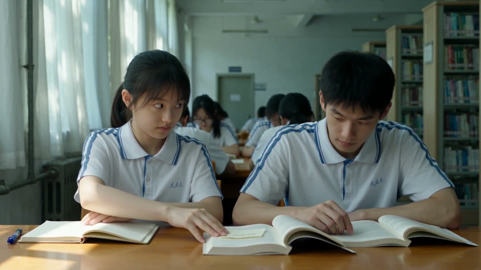

<!-- Generated by scripts/build_readme.py. Edit site.config.json, content/prompts.json, and generator scripts. -->

<a id="case-library-note-youth-short"></a>

# Library Note — Silent High-School Youth Short

[← Back to collection](../../README.md)

**Origin**: `community` · **Task**: `T2V` · **Audio**: `Yes` · **Status**: `Source-linked`

7-shot 30-second live-action Chinese campus short driven by subtle gestures, handwritten Chinese note edits, and pure library room foley.

<a href="https://raphael-assets.colorepistle.com/materials/8b4ed9b9-5c66-4c49-b40c-a011d18ab44f.mp4"></a>

▶ **[Watch audio-enabled MP4](https://raphael-assets.colorepistle.com/materials/8b4ed9b9-5c66-4c49-b40c-a011d18ab44f.mp4)**

**Full Prompt**

```text
【影片类型与时长】 制作一支30秒、16:9横屏、真人实拍质感的青春校园短片。故事发生在初夏午后的中国高中图书馆，男女主均为18岁的高三学生。环境、校服、书本和生活细节明确属于中国校园，影像采用清透、略带暗沉青绿色调的日式青春电影质感。全片围绕一张夹在书里的小纸条展开：女生偷偷递出邀请，男生故意停顿，让她误以为被拒绝，最后把“明天见”改成“每天见”。两个人没有表白，也没有说话，只通过一次推书、一瞬触碰、一张纸条和桌下悄悄靠近的鞋尖，让暧昧自然发生。 整体情绪从女生的紧张试探，经过男生故意逗她的小小悬念，发展到心意被回应后的羞涩与默契。最后停留在两人已经知道彼此心意，却仍装作认真读书的瞬间。没有产品展示、没有品牌标识、没有广告文案，也不出现片尾抒情字幕。
【整体视觉风格】 真实人物、真实摄影、自然表演。画面细腻、含蓄，有午后自习时压低声音的安静感，也有青春期藏不住的小动作。镜头认真观察眼睛、手指、纸张和两人之间的距离，情绪通过动作发生，不依赖大幅度表情与频繁慢镜头。 整体色彩由柔和灰白、低饱和青绿、旧木色和校服藏青组成。图书馆深处的阴影轻微偏青绿，白色窗帘和白色校服保留柔软的灰白层次，人物皮肤呈自然浅暖色，与冷一些的环境形成细微分离。曝光略微压低，但面部仍然干净通透，不能灰暗发脏。黑色头发保留发丝层次，木桌不偏浓烈橙黄，绿色窗外景色不鲜艳刺眼。 自然光从画面侧后方的大窗进入，先经过薄白窗帘，再柔和地照到书页、手指和脸颊。少量午后阳光落在桌面上，形成边缘模糊的光斑，随着树叶与窗帘轻轻变化。高光带极轻微的柔化，避免整片泛白、过曝、强烈炫光或浓重柔焦。画面保持清晰、低噪点，不添加明显胶片颗粒、复古划痕和过度锐化。 镜头运动缓慢而克制，近景中两人的眼睛清楚，背景书架与窗外树叶适度虚化。只有指尖接近、纸条翻回来的瞬间稍作停顿，其余动作保持真实速度，让30秒内的叙事自然流动。
【场景与中国校园氛围】 主要场景为中国普通高中的图书馆阅览区，初夏下午最后一节自主阅读课。图书馆安静、整洁，带有使用多年的生活痕迹。浅米白墙面，深绿色或灰绿色金属窗框，窗下有普通暖气片，薄白窗帘被半开的窗户吹得轻轻鼓起。窗外能看到香樟树、教学楼走廊与操场边缘，远处偶尔有穿校服的学生经过。 阅览区摆放长条形浅棕木桌，桌面有细小划痕与自然磨损，搭配木面金属脚靠背椅。书架上是不同厚度的中文书籍，书脊带常见的索书标签，不出现日文书名或日式校园装饰。远处墙面可以有一块小而朴素的“保持安静”提示牌，文字只作为环境细节，不占据主要画面。 男女主并肩坐在同一张桌子靠窗的一侧，女生位于画面左侧，男生位于画面右侧，肩膀之间起初隔着约二十厘米。镜头主要从桌子对面拍摄，因此能看到两人的正面与上半身。女生左侧靠窗，男生右侧靠过道，空间方向全片保持一致。 桌面物品有限且位置清楚：女生面前一本摊开的中文散文集，一支深蓝色中性笔，一本浅色笔记本；男生面前一本打开的书和一支黑色中性笔。两人之间留出足够推书的空间。桌面没有饮料广告、食品包装或品牌露出。后景只保留两三个安静读书的学生，始终虚化，不参与男女主的互动。
【女主外貌与服装】 女主为18岁中国高中女生，脸型柔和，略带自然的青春饱满感。黑色眼睛清楚明亮，眼尾柔和，眉毛自然平直，鼻子比例适中，嘴唇是未经明显修饰的淡粉色。脸上保留真实细腻的皮肤纹理，不使用浓妆、修容、假睫毛或明显唇釉。她的美感来自干净的眼神、安静的神情和表情中藏不住的小紧张。 黑色头发在脑后扎成低马尾，额前是稀疏自然的碎刘海，耳边有一两缕没有扎进去的短发。发型具有真实上学时的随意感，不做精致卷发。她紧张时会下意识抿住嘴唇，视线短暂落向桌面；开心时先是眼睛松下来，随后嘴角才慢慢扬起。 服装为中国高中常见的夏季运动校服，脚穿普通白色帆布鞋，鞋边有轻微使用痕迹。整体是朴素的中国学生穿搭。 她不是一味害羞。她会主动写下纸条，也会在误会男生拒绝时，带一点不服气地想把书收回来。最后发现男生回应，她先看他一眼，再低头忍笑，保留自己的小骄傲。
【男主外貌与服装】 男主为18岁中国高中男生，身形修长，肩背自然舒展，清瘦但不单薄。脸型略长，轮廓干净，眉毛稍浓，黑色眼睛带一点慵懒与顽皮。嘴角习惯轻微偏向一侧，笑容有一点故作镇定的坏，但不能显得油滑或成熟世故。 黑色短发自然蓬松，额前碎发轻轻垂落，没有发胶塑造的尖刺，也没有遮住眼睛的长刘海。面部无胡须，皮肤自然，鼻梁与眼下有柔和阴影。他的吸引力来自轻松的姿态、看穿女生小心思后又忍不住回应的眼神，以及自己其实也紧张，却装得很镇定的反差。 男生穿与女生同校同款的短袖校服，普通灰白色运动鞋。坐姿起初比女生松一点，一只前臂搭在桌上，另一只手压着书页，但不翘椅子、不把脚架到桌上。 他不会做“邪魅一笑”、挑下巴或故意贴脸之类夸张动作。暧昧主要表现为：明明注意到女生在写纸条，却不立刻看她；读到邀请后故意停一拍；改完字又装作继续读书；最后悄悄把自己的椅子往她那边挪近一点。
【核心道具与纸条文字】 纸条是一张从普通横线笔记本上取下来的小纸，约手掌一半大小，纸张浅白，边缘略有撕开的不齐。不要使用爱心形信纸、粉色信封、贴纸或精致礼物，让它像真实学生临时写下的一句话。 女生写在纸条上的内容为： “明天，还坐这里吗？” 使用清楚、自然、略显认真但并不花哨的中文手写体。男生的回应不另写一大段文字，而是在“明天”的“天”字上画一条细细的划线，在旁边补上“每天”，再在句子下方写： “给你留位。” 纸条最后可清楚读出原来的邀请和他的修改，形成“明天”变“每天”的视觉转折。纸条特写时只出现规定文字，不生成乱码、额外表白、英文或其他句子。字迹在前后镜头保持一致，修改痕迹必须保留。
【声音设计】 全片只使用环境音、动作拟音与人物呼吸声。无背景音乐、无旋律、无钢琴、无弦乐、无电子氛围音、无心跳节拍、无旁白、无对白。 声音突出图书馆内近处与远处的空间层次：近处是笔尖划纸、纸条摩擦书页、手掌移动、衣袖擦过桌面、椅脚轻微摩擦、翻页与压低的呼吸；远处是吊扇或壁扇持续而轻的机械运转、窗外树叶摩擦、偶尔一声鸟鸣，以及操场传来的极远且无法分辨内容的活动声。不要出现带旋律的下课铃。 情绪变化时可以适度降低远处环境声，让细小动作更清楚，但不能突然完全静音，也不添加人为制造的悬念音效。最后用一次几乎同时发生的翻页声自然结束。
[00:00–00:04] 镜头一：女生藏在书页后的心事 85mm正面面部近景开场，女生低头看着桌面，白色校服领口与蓝色肩线清楚可见。窗边柔光落在她靠窗一侧的脸颊上，另一侧是细腻的浅青灰阴影。她的目光并没有真正停在书页上，而是轻轻向右侧移动，偷偷看一眼坐在旁边的男生。 男生只以虚化的肩膀和手臂出现在画面边缘，不抢走开场视觉中心。女生确认他像是在读书，便收回视线，轻轻抿一下嘴。 切俯斜角手部近景，她用深蓝中性笔在小纸条上写下最后一个问号。纸条完整内容已经写好：“明天，还坐这里吗？”笔尖停在纸面上方半秒，她似乎还在犹豫要不要递出去。另一只手的指尖轻轻压着纸角，手指自然，没有反复捏皱纸张。 音效：安静的风扇机械声、细微笔尖划纸声、窗帘被风带动的一次轻响。
[00:04–00:08] 镜头二：借一本书，递一句话 50mm正面双人中近景，女生把纸条平放在散文集打开的书页上，位置靠近书页中央，随后用指尖压着书角，将整本打开的书沿桌面向男生那边推过去约十五厘米。动作很轻，不惊动后面的学生。 她没有直接看他，而是用眼角留意他的反应，另一只手假装整理自己的笔记本。男生先看向慢慢进入自己视线的书，随后低头看见纸条。 切书页与手部特写。男生原本搭在桌面的左手伸过来按住书边，女生的右手还没有完全收回。两人的食指侧面在书角附近轻轻碰到，接触只持续一瞬。女生的手指先缩了一下，随后收回到自己身前；男生的手停住，没有追过去握她。 音效：书本沿木桌滑动的轻响、纸条摩擦书页的沙沙声、女生衣袖轻擦桌沿的声音。触碰瞬间不添加音效。
[00:08–00:12] 镜头三：他看懂了，却故意不说 85mm男生面部近景，男生读完纸条，眼睛在“明天”两个字上停了一下。嘴角有一个很小、几乎被压住的上扬，他稍稍低头，把这个笑藏起来。 他侧过眼睛看女生。女生察觉到目光，立刻把视线转向自己的笔记本，假装认真看字，但手里的笔握得比刚才更紧。 切正面双人近景，男生用左手压住纸条，右手拿起黑色中性笔，在纸上划了一笔。机位从略低的侧前方拍摄，暂时看不到他具体写了什么，只能看见笔尖短促移动，以及女生目光被那一笔吸引。 男生写完后，没有立即把书还给她，而是把笔放下，故意将目光移回自己原来的书上，神情装得平静。 音效：笔帽或笔身触到桌面的轻响，短促的一次划线声，远处有人轻轻翻过一页书。
[00:12–00:16] 镜头四：她以为，他划掉了邀请 女生面部近景。她看见男生刚才划线的动作，却没看见具体内容，眼睛里的期待慢慢收住。她轻轻吸一口气，抿住嘴，露出一点“算了，当我没写”的局促与不服气。 她伸出右手，准备把夹着纸条的书拉回自己面前。镜头切到桌面，女生的指尖刚碰到书角，男生的左手已经轻轻按住书的另一边。 男生没有按她的手，也没有拉住她的手腕，只是压住书页，阻止书立刻被抽走。他抬眼看她，嘴角有一点顽皮，却比之前柔和。随后，他主动把书转正，将纸条朝她的方向推近，让她能够看清。 两人的动作都很轻，桌上书页只发生自然滑动，不能出现双方用力抢书的喜剧表演。 音效：女生一次细微吸气，手掌与纸张接触的声音，书脊沿桌面移动的轻响。风扇声与窗外树叶声持续。
[00:16–00:20] 镜头五：“明天”被改成“每天” 俯拍纸条特写，镜头稳定，给文字足够清楚的阅读时间。原句“明天，还坐这里吗？”仍然可辨认，其中“天”字被一条细线划过，旁边清楚补写“每天”，下方多了一句：“给你留位。” 男生的手指只轻轻点一下新写的“每天”，随后离开画面，不反复敲击，不比心。 切女生面部近景。她先看着纸条，眼睛轻轻睁大一点，随后眼神松下来，嘴角不受控制地扬起。她想忍住笑，于是低下头，但笑意仍然留在眼角。耳边一缕头发被风吹动，她没有立刻整理，注意力全在纸条上。 这一段不要把脸颊突然染成夸张的红色，也不要添加柔光闪烁。羞涩依靠眼神、呼吸和低头表现。 音效：男生指尖轻碰纸面的声音，窗外一阵较清楚的树叶沙沙声，女生很轻的一次呼气。
[00:20–00:25] 镜头六：都在看书，谁也没看进去 50mm正面上半身双人近景，女生在左，男生在右，两个人都保持近正面的面部角度。女生把纸条小心夹进自己笔记本的内页，再合上一半，指尖停在封面上。 男生看见她收好纸条，嘴角轻轻扬起。女生抬眼看他，两人的视线这次没有立即避开，停留大约一秒。男生原先故作轻松的表情逐渐变得有点不好意思，先移开目光，低头看书。女生发现他也会紧张，眼睛里带着一点很轻的得意。 随后男生将自己的椅子向女生方向挪近几厘米，动作谨慎，怕椅脚发出声音。女生听见轻响，看一眼两人缩短的距离，没有躲开，只把自己的书稍微往中间移，让两人可以一起看。 肩膀仍然没有紧贴，只留下比开场更近、让人能察觉的距离。 音效：笔记本合拢的轻响，椅脚短暂而轻微的摩擦声，衣料移动声。没有说话，没有配乐。
[00:25–00:30] 镜头七：桌下的距离，已经回答了 先用一秒半拍摄桌下鞋部近景，机位从桌子对面平视向下，不拍裙底。女生穿白色帆布鞋，男生穿灰白运动鞋，两人都穿深蓝校服长裤。随着男生椅子挪近，他的鞋侧轻轻碰到女生鞋边。他察觉后停住，没有继续挤过去。 女生的脚起初微微缩了一点，随后没有离开，而是轻轻落回原来的位置，让两只鞋仍然挨着。动作很小，不勾脚、不缠腿，保持自然青涩。 切回正面双人中近景，两人已经一起看着放在中间的书。女生伸手准备翻页，男生也同时伸手，发现撞上同一个动作后，男生先收回手，让她翻。两人嘴角各自露出一点藏不住的笑，仍然没有抬头互看。 镜头缓慢后退少许，把轻轻飘动的白窗帘、中文书架、校服和安静的阅览室重新纳入画面。桌上的笔记本边缘露出一点收好的纸条，字迹不必再次展示。最后停在两人并肩读书的画面，保留一秒自然呼吸，不出现标题、旁白或结束文案。 音效：鞋底轻触与椅脚的极轻声响，女生翻过书页的一次清晰沙沙声，窗帘轻动与持续的风扇声。以自然环境声结束。
【人物表演与连续性要求】 女主的情绪顺序必须是：偷偷观察、鼓起勇气、触碰后紧张、误以为被拒绝、发现回应、羞涩开心、主动允许距离靠近。男主的情绪顺序必须是：察觉她的小动作、看懂邀请、故意逗她、及时解释、看见她收好纸条后开心、真正对视时反而局促。不能从头到尾都保持固定微笑。 纸条始终只有一张，由女生写好放在打开的书上，男生直接在同一张纸上修改，再随书推回，最后由女生夹进自己的笔记本。书本移动路径、笔的颜色、两人的左右位置、发型、校服和桌面物品保持一致。 全片的暧昧来自主动试探后的回应，以及双方自愿缩短的距离。避免强行搂抱、抓手腕、堵住去路、贴脸亲吻或夸张挑逗。保持中国校园的真实服装和环境，保留日式青春影像的细腻光线、低饱和青绿色调、干净肤色与情绪留白。全片只用真实环境音和动作拟音，不出现任何背景音乐、旁白、对白、广告内容或片尾抒情字幕。
```

| Parameter | Value |
| --- | --- |
| Model | MAGI-2 (flagship) |
| Task type | t2v |
| Duration / FPS | 29.8s · 30 fps |
| Resolution / Ratio | 1080p · 16:9 |
| Audio mode | sfx (audio=True) |

[Original source](https://x.com/TanLuAI/status/2125607851343409220) · Creator: [@TanLuAI](https://x.com/TanLuAI) · 2026-11-25

> Creator reported pure text-to-video; full prompt posted at https://x.com/TanLuAI/status/2125607857148301811.

**[Generate similar on Raphael →](https://raphael.app/ai-video-generator?utm_source=github&utm_medium=repository&utm_campaign=magi_2_launch&utm_content=case_library-note-youth-short&utm_term=en)**
