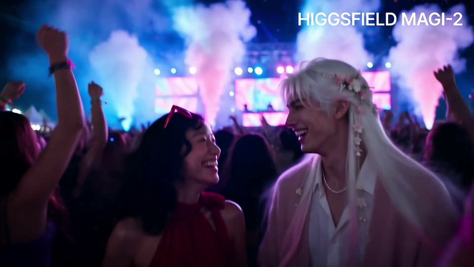

<!-- Generated by scripts/build_readme.py. Edit site.config.json, content/prompts.json, and generator scripts. -->

<a id="case-neon-night-run-edm"></a>

# Neon Night Run Music Video (128 BPM EDM)

[← Back to collection](../../README.md)

**Origin**: `community` · **Task**: `T2V` · **Audio**: `Yes` · **Status**: `Source-linked`

Concise single-paragraph prompt generating a 30-second 16mm handheld neon music video synced end-to-end with a continuous 128 BPM EDM soundtrack.

<a href="https://raphael-assets.colorepistle.com/materials/53df4174-2cc7-4d5f-9862-5dfce6bacb32.mp4"></a>

▶ **[Watch audio-enabled MP4](https://raphael-assets.colorepistle.com/materials/53df4174-2cc7-4d5f-9862-5dfce6bacb32.mp4)**

**Prompt**

```text
Generate with full audio: a loud continuous EDM music soundtrack must play from the first second to the last. live-action music video, young couple madly in love running through one night: open-air concert → night market past a ferris wheel (piggyback ride) → glass spiral stairs → rooftop → hotel lobby spin → retro-modern corridor → freestyle dance and hug at a neon window. Raw handheld camera chasing them, vivid neon colors, 16mm grain, loud 128 BPM EDM with drops synced to the scenes.
```

| Parameter | Value |
| --- | --- |
| Model | MAGI-2 (flagship) |
| Task type | t2v |
| Duration / FPS | 30.2s · 30 fps |
| Resolution / Ratio | 1080p · 16:9 |
| Audio mode | music (audio=True) |

[Original source](https://x.com/NyaiiBubu/status/2125730219499962783) · Creator: [@NyaiiBubu](https://x.com/NyaiiBubu) · 2026-11-25

> Creator reported MAGI-2 via Higgsfield; prompt posted at https://x.com/NyaiiBubu/status/2125732070181978319.

**[Generate similar on Raphael →](https://raphael.app/ai-video-generator?utm_source=github&utm_medium=repository&utm_campaign=magi_2_launch&utm_content=case_neon-night-run-edm&utm_term=en)**
