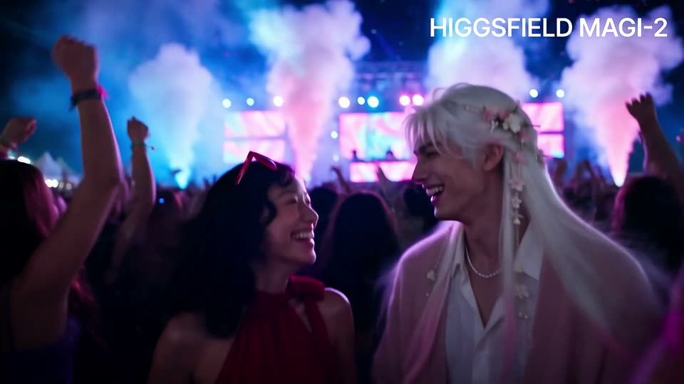

<!-- Generated by scripts/build_readme.py. Edit site.config.json, content/prompts.json, and generator scripts. -->

<a id="case-neon-night-run-edm"></a>

# 霓虹夜奔约会（128 BPM 电子乐）

[← 返回合集](../../README.zh-CN.md)

**来源类型**: `community` · **任务**: `T2V` · **音画**: `Yes` · **状态**: `来源收录`

精简一段式英文提示词，生成 30 秒 16mm 手持霓虹夜景音乐短片，全程对齐 128 BPM 电子音乐节拍与落点。

<a href="https://raphael-assets.colorepistle.com/materials/53df4174-2cc7-4d5f-9862-5dfce6bacb32.mp4"></a>

▶ **[播放有声视频原片](https://raphael-assets.colorepistle.com/materials/53df4174-2cc7-4d5f-9862-5dfce6bacb32.mp4)**

**提示词**

```text
Generate with full audio: a loud continuous EDM music soundtrack must play from the first second to the last. live-action music video, young couple madly in love running through one night: open-air concert → night market past a ferris wheel (piggyback ride) → glass spiral stairs → rooftop → hotel lobby spin → retro-modern corridor → freestyle dance and hug at a neon window. Raw handheld camera chasing them, vivid neon colors, 16mm grain, loud 128 BPM EDM with drops synced to the scenes.
```

| 参数 | 配置 |
| --- | --- |
| 模型 | MAGI-2 (flagship) |
| 任务类型 | t2v |
| 时长 / 帧率 | 30.2s · 30 fps |
| 分辨率 / 比例 | 1080p · 16:9 |
| 音频模式 | music (audio=True) |

[原始来源](https://x.com/NyaiiBubu/status/2125730219499962783) · 作者: [@NyaiiBubu](https://x.com/NyaiiBubu) · 2026-11-25

> 作者标注通过 Higgsfield 使用 MAGI-2 生成；提示词见原回复 https://x.com/NyaiiBubu/status/2125732070181978319。

**[在 Raphael 上生成同类视频 →](https://raphael.app/ai-video-generator?utm_source=github&utm_medium=repository&utm_campaign=magi_2_launch&utm_content=case_neon-night-run-edm&utm_term=zh-CN)**
