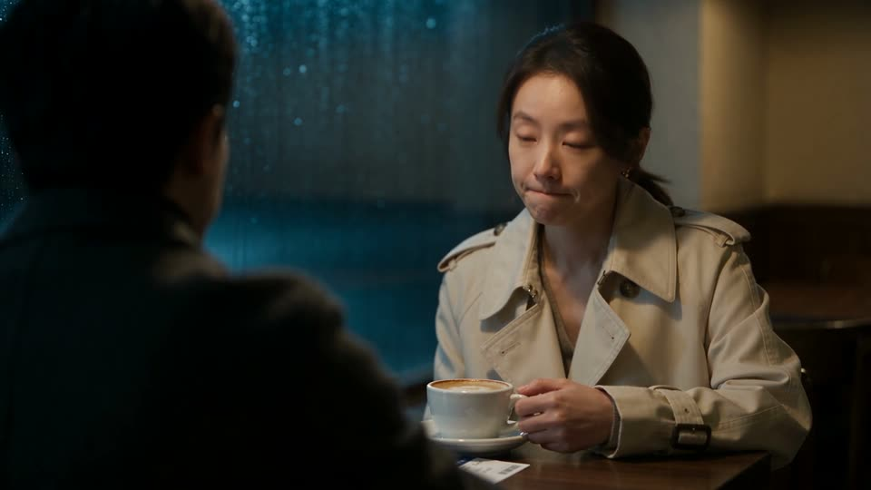

<!-- Generated by scripts/build_readme.py. Edit site.config.json, content/prompts.json, and generator scripts. -->

<a id="case-rainy-cafe-boarding-pass"></a>

# Rainy Night Cafe Boarding Pass

[← Back to collection](../../README.md)

**Origin**: `community` · **Task**: `T2V` · **Audio**: `Yes` · **Status**: `Source-linked`

Two-character dramatic dialogue in a rainy late-night cafe with strict Mandarin lip-sync and two exact hard cuts at 7s and 14s.

<a href="https://raphael-assets.colorepistle.com/materials/74ab8314-1821-4d7e-bd69-c39b4e840ba8.mp4"></a>

▶ **[Watch audio-enabled MP4](https://raphael-assets.colorepistle.com/materials/74ab8314-1821-4d7e-bd69-c39b4e840ba8.mp4)**

**Full Prompt**

```text
MAGI-2 DIRECTOR PROMPT
Duration: 20秒
Aspect ratio: 16:9
Reference: 程远＝一名三十二岁上下的东亚男性，短黑发微乱，穿深灰羊毛大衣配黑色高领毛衣；林夏＝一名三十岁上下的东亚女性，低马尾，穿米白风衣；全片两人面部、发型、体型与穿着完全一致。
Audio: 深夜咖啡馆低沉的冰箱嗡鸣、窗外淅沥雨声、陶瓷杯轻碰碟子的脆响、衣料摩擦声；现场中文对白（台词见节拍内），口型与台词严格同步；无旁白、无音乐、无字幕
Overall style: 8K IMAX 超写实电影，Lubezki×Deakins 摄影，只用场景内实际光源，毛孔级皮肤，180°快门运动模糊，物理重量真实，拒绝游戏CG感

GLOBAL CONTINUITY
Setting:
深夜临街小咖啡馆靠窗卡座，深胡桃木桌面有两只白瓷咖啡杯与一张折成两半的登机牌；左侧是挂满雨珠的整面落地玻璃窗，窗外是模糊的城市湿漉街景与暖黄路灯。
Main subject:
程远与林夏为双主角，身份、面部与服装全程一致。
Props:
白色纸质登机牌折成两半，平放在深胡桃木桌面正中央，距程远右手约 15 厘米。
Blocking:
程远坐画左面朝画右，林夏坐画右面朝画左，两人隔着宽约 0.9 米的木桌正对而坐，互不遮挡。
Lighting:
室内主灯关闭，仅靠桌面正上方一盏低垂暖钨丝吊灯（2800K）照亮桌面与两人半侧脸，窗外街灯冷蓝反光轻擦两人肩背。摄影机始终在人物阴影侧，无任何外部补光。
Color:
60:30:10——深棕暗影 / 暖钨丝琥珀 / 窗外冷蓝反光点缀

CAMERA CONTINUITY
全片严格只有 2 次硬切，分别在第 7.0 秒和第 14.0 秒，无过渡、无淡入淡出。前两段采用极轻的手持呼吸感 (Subtle handheld shake)，最后一段切为几乎察觉不到的缓慢推近 (Slow push-in / Dolly in)。

PERFORMANCE ENGINE
程远｜目的：把登机牌推回给林夏劝她别走 障碍：说出口就等于承认自己输了 隐藏的恐惧：她真的会头也不回 保护策略：用故作轻松的慢动作掩盖手抖
林夏｜目的：等程远亲口说一句留下来 障碍：尊严不允许先低头 隐藏的恐惧：他只是客套 保护策略：压低视线盯住杯口不接话
情绪曲线：控制 → 加压 → 裂缝 → 暴露 → 残留

0.0–7.0秒｜推牌试探
镜头开场即在运动中，程远右手食指和中指压在桌面登机牌边缘，把登机牌顺着木纹慢慢往林夏那边推过 10 厘米后手指停住；林夏左手握着白瓷杯柄，拇指在杯沿轻轻摩挲半圈，眼睛盯着桌面没抬头。
7.0–14.0秒｜硬切对峙与开口
第 7.0 秒动量匹配硬切 (Match cut) 至林夏半身胸像 (Medium close-up / Bust shot)。林夏听见纸张摩擦桌面的声音停下，先轻吸一口气，才慢慢抬眼直视画左的程远，嘴角先扯出一丝极淡的苦笑，随后笑意从眼里退掉，开口说出台词。
14.0–20.0秒｜反打破防与残留
第 14.0 秒同轴反打硬切 (Cut on axis) 至程远面部特写 (Close-up)。程远原本紧绷的下颌微微一松，喉结上下滚动一次，眼眶迅速泛湿泛光但不落泪，右手手指无意识把登机牌边角轻轻压平，低声接上一句台词，说完没有移开视线，停在沉默呼吸里。

Performance:
①（7.0–14.0秒）触发：登机牌停在杯边 → 面部：眉毛内侧极轻微抬起，下唇抿一下再松开 → 目光：从杯口缓缓抬至画左锁死对方 → 呼吸：轻吸气后平稳吐字 → 结束状态：眼神发亮但嘴角归于平直。
台词：「你每次都这样，把选择推给我。」（朝画左程远说，语速偏慢、声音轻而克制，在“这样”后停顿 0.5 秒，嘴型必须和“你-每-次-都-这-样-把-选-择-推-给-我”每个字的发音完全对上）
②（14.0–20.0秒）触发：听完林夏的话 → 面部：咬肌松开、眼皮微颤、眼球泛水光但眼泪不得早于第 20.0 秒落下 → 呼吸：鼻腔短促吸气一次 → 结束状态：嘴唇闭合，胸口缓慢起伏。
台词：「这次是我不敢留你。」（朝画右林夏说，音量压低、尾音略带气声，嘴型必须和“这-次-是-我-不-敢-留-你”每个字的发音完全对上）

Environment:
窗外雨滴沿玻璃缓慢滑落，远处偶尔有一辆车尾灯的红光在湿漉玻璃上拉出模糊光斑，咖啡馆内其余座位空无一人。
Camera:
0.0–7.0秒 35mm 双人侧景 (Two-shot) 手持呼吸感极缓横移 → 7.0秒硬切 50mm 林夏过肩半身胸像 (Medium close-up / Bust shot) 稳住焦平面 → 14.0秒硬切 85mm F1.4 程远面部特写 (Close-up) 极缓慢推近 (Slow push-in / Dolly in) 约 6 厘米。
Constraints:
登机牌始终留在桌面两人之间，不得凭空消失或变成其他纸张；两人的左右站位轴线全程锁死；口型与台词逐字严格同步，说完立刻闭唇。

---
Negative:
改变程远和林夏人物造型，重新设计服装，服装漂移，面部漂移，人物替换
多余切镜，机位瞬移，越轴，场景跳变，变焦推拉
静止发呆开场，表情一步到位，开场就崩溃，提前流泪，夸张肢体动作
登机牌消失，咖啡杯位置跳变，多手多指，口型与中文台词错位
动漫渲染，游戏CG，塑料皮肤，过度磨皮，正面补光，反光板，柔光箱
字幕，屏幕文字，水印，品牌标志，旁白，额外对白，背景音乐
```

| Parameter | Value |
| --- | --- |
| Model | MAGI-2 (flagship) |
| Task type | t2v |
| Duration / FPS | 20.3s · 25 fps |
| Resolution / Ratio | 1080p · 16:9 |
| Audio mode | dialogue (audio=True) |

[Original source](https://x.com/johnAGI168/status/2125480417847353448) · Creator: [@johnAGI168](https://x.com/johnAGI168) · 2026-11-25

> Creator reported text-to-video generation; prompt posted at https://x.com/johnAGI168/status/2125480454518133081. Video metrics measured from the archived MP4.

**[Generate similar on Raphael →](https://raphael.app/ai-video-generator?utm_source=github&utm_medium=repository&utm_campaign=magi_2_launch&utm_content=case_rainy-cafe-boarding-pass&utm_term=en)**
