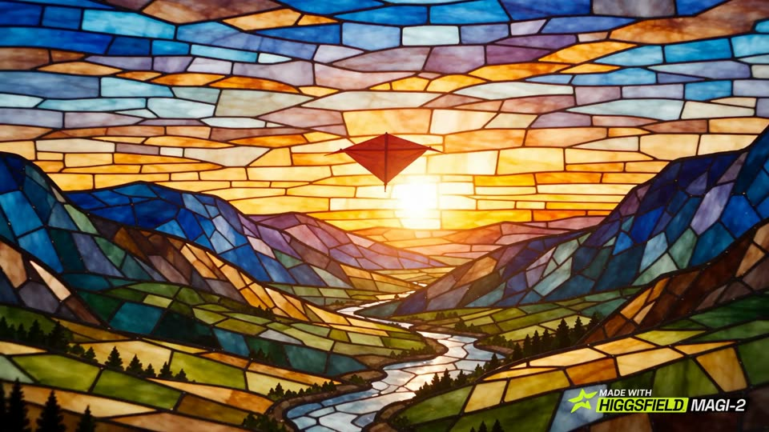

<!-- Generated by scripts/build_readme.py. Edit site.config.json, content/prompts.json, and generator scripts. -->

<a id="case-red-paper-kite-five-styles"></a>

# Red Paper Kite Across Five Art Styles

[← Back to collection](../../README.md)

**Origin**: `community` · **Task**: `T2V` · **Audio**: `Yes` · **Status**: `Source-linked`

30-second continuous take morphing every 6 seconds across charcoal sketch, watercolor, stained glass, 1970s 35mm film, and photoreal rooftop dusk.

<a href="https://raphael-assets.colorepistle.com/materials/32b60448-840a-4f10-9ec9-1c6a1d8ac5ba.mp4"></a>

▶ **[Watch audio-enabled MP4](https://raphael-assets.colorepistle.com/materials/32b60448-840a-4f10-9ec9-1c6a1d8ac5ba.mp4)**

**Full Prompt**

```text
One continuous 30-second take, no cuts. The camera glides forward at a steady, unhurried pace behind a small red paper kite drifting on the wind, keeping it in the upper third of frame. The world around the kite transforms seamlessly every six seconds while the kite itself never changes.

0-6s: a hand-drawn charcoal sketch of rolling hills on textured off-white paper, smudged graphite clouds.

6-12s: the lines bleed into loose watercolor washes, a valley of soft blue and ochre, pigment blooming at the edges.

12-18s: the valley hardens into a stained-glass mosaic landscape, bold dark outlines, sunlight glowing through colored glass panes.

18-24s: the glass melts into a warm 1970s 35mm film-stock coastal road, visible grain, halation, faded teal and orange.

24-30s: dusk over a modern photoreal city rooftop, unbranded window lights flickering on, the kite settling gently into the hands of a child standing on the roof.
Audio: steady soft wind throughout and a single gentle solo piano melody that slowly builds. No voices.
```

| Parameter | Value |
| --- | --- |
| Model | MAGI-2 (flagship) |
| Task type | t2v |
| Duration / FPS | 30.2s · 25 fps |
| Resolution / Ratio | 1080p · 16:9 |
| Audio mode | mixed (audio=True) |

[Original source](https://x.com/Dheepanratnam/status/2125658296052813844) · Creator: [@Dheepanratnam](https://x.com/Dheepanratnam) · 2026-11-25

> Creator reported MAGI-2 via Higgsfield; prompt posted at https://x.com/Dheepanratnam/status/2125658298460570035.

**[Generate similar on Raphael →](https://raphael.app/ai-video-generator?utm_source=github&utm_medium=repository&utm_campaign=magi_2_launch&utm_content=case_red-paper-kite-five-styles&utm_term=en)**
