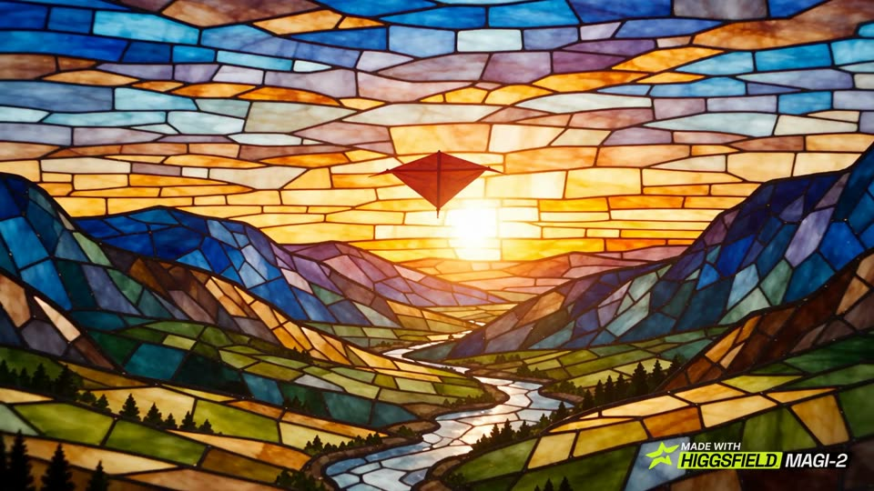

<!-- Generated by scripts/build_readme.py. Edit site.config.json, content/prompts.json, and generator scripts. -->

<a id="case-red-paper-kite-five-styles"></a>

# 红纸风筝穿过五种画风

[← 返回合集](../../README.zh-CN.md)

**来源类型**: `community` · **任务**: `T2V` · **音画**: `Yes` · **状态**: `来源收录`

30 秒一镜到底，跟随同一只红纸风筝每 6 秒无缝穿越炭笔素描、水彩、彩绘玻璃、70 年代胶片与实景天台黄昏。

<a href="https://raphael-assets.colorepistle.com/materials/32b60448-840a-4f10-9ec9-1c6a1d8ac5ba.mp4"></a>

▶ **[播放有声视频原片](https://raphael-assets.colorepistle.com/materials/32b60448-840a-4f10-9ec9-1c6a1d8ac5ba.mp4)**

**完整原始提示词**

```text
One continuous 30-second take, no cuts. The camera glides forward at a steady, unhurried pace behind a small red paper kite drifting on the wind, keeping it in the upper third of frame. The world around the kite transforms seamlessly every six seconds while the kite itself never changes.

0-6s: a hand-drawn charcoal sketch of rolling hills on textured off-white paper, smudged graphite clouds.

6-12s: the lines bleed into loose watercolor washes, a valley of soft blue and ochre, pigment blooming at the edges.

12-18s: the valley hardens into a stained-glass mosaic landscape, bold dark outlines, sunlight glowing through colored glass panes.

18-24s: the glass melts into a warm 1970s 35mm film-stock coastal road, visible grain, halation, faded teal and orange.

24-30s: dusk over a modern photoreal city rooftop, unbranded window lights flickering on, the kite settling gently into the hands of a child standing on the roof.
Audio: steady soft wind throughout and a single gentle solo piano melody that slowly builds. No voices.
```

| 参数 | 配置 |
| --- | --- |
| 模型 | MAGI-2 (flagship) |
| 任务类型 | t2v |
| 时长 / 帧率 | 30.2s · 25 fps |
| 分辨率 / 比例 | 1080p · 16:9 |
| 音频模式 | mixed (audio=True) |

[原始来源](https://x.com/Dheepanratnam/status/2125658296052813844) · 作者: [@Dheepanratnam](https://x.com/Dheepanratnam) · 2026-11-25

> 作者标注通过 Higgsfield 使用 MAGI-2 生成；完整提示词见原回复 https://x.com/Dheepanratnam/status/2125658298460570035。

**[在 Raphael 上生成同类视频 →](https://raphael.app/ai-video-generator?utm_source=github&utm_medium=repository&utm_campaign=magi_2_launch&utm_content=case_red-paper-kite-five-styles&utm_term=zh-CN)**
