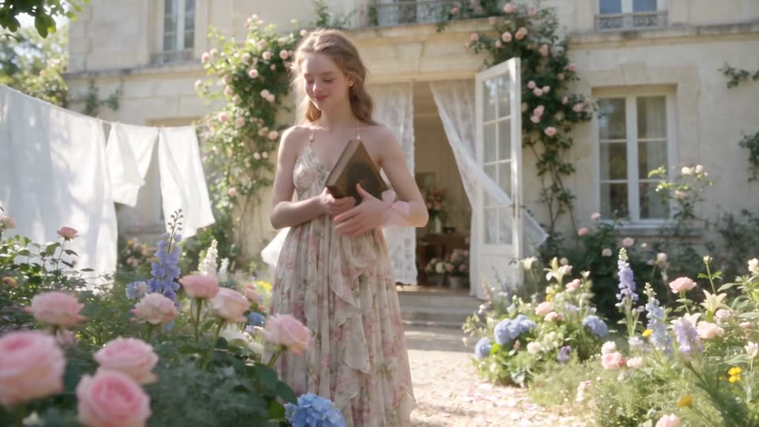

<!-- Generated by scripts/build_readme.py. Edit site.config.json, content/prompts.json, and generator scripts. -->

<a id="case-rococo-garden-three-room-oner"></a>

# Rococo Garden Three-Room One-Take

[← Back to collection](../../README.md)

**Origin**: `community` · **Task**: `OMNI-REF` · **Audio**: `Yes` · **Status**: `Source-linked`

30-second unbroken Steadicam single take traversing garden, boudoir, and sunlit salon locked by 4 reference images with layered spatial audio.

<a href="https://awesome.raphael.app/materials/0b3445d5-9078-4c49-b3e8-b0f6189f23b3.mp4"></a>

▶ **[Watch audio-enabled MP4](https://awesome.raphael.app/materials/0b3445d5-9078-4c49-b3e8-b0f6189f23b3.mp4)**

**Full Prompt**

```text
【影像设定与风格锁定】
法式古典极繁浪漫电影炫技长镜头，融合《傲慢与偏见》灵动调度与索菲亚·科波拉《绝代艳后》马卡龙洛可可美学。总时长 30 秒，16:9 横屏，35mm 柯达胶片配 1/4 黑柔滤镜实拍质感，高调清透的奶油暖白晨光与梦幻高光柔晕。全程采用 28mm 自然广角视感与斯坦尼康复合运镜（穿花抬升、弧线环绕、脱靶俯拍、穿门横摇），全片严格保持单一连续的一镜到底长镜头，绝不切镜。

【素材分工与角色/场景锁定】
严格按以下 4 张参考图分工锁定主角色与三段连续空间，全程不得换脸、换装或漂移画风：
- 女主角（严格参考图片 1）：将图片 1 右侧人像头部与全身服装自然融合为真实立体的完整人物（严禁无头残缺或灰底排版）。约 20 岁绝美法式少女，极度细腻白皙的瓷感公主肌与自然柔粉面颊，清澈浅灰绿眼眸，披散及腰的浅茶棕色长波浪大卷发；身穿珍珠串珠细挂脖的奶油白底粉玫瑰碎花多层荷叶边雪纺长裙，左手腕系淡粉色薄纱蝴蝶结，脚穿米白短袜与复古黑色玛丽珍皮鞋。
- 伴奏配角（仅在空间 3 出现，避免与女主混淆）：一名身穿素雅浅天蓝色复古棉布长裙、盘起金棕色低发髻的年轻姐妹，仅以侧影坐在左侧立式钢琴前弹琴。
- 空间 1（室外起点，严格参考图片 2）：沐浴灿烂晨光的法式鲜花碎石花园小径，左侧挂着透光发亮的白色亚麻床单，花径两侧盛开粉玫瑰、蓝绣球与飞燕草，正前方是攀满粉蔷薇的奶油白老宅与完全敞开的法式双开落地玻璃门，雪白提花蕾丝长纱帘被晨风吹向室外。
- 空间 2（室内中段，严格参考图片 3）：穿过敞开大门即进入的鲜花白蕾丝复古闺房，左为透光白蕾丝落地窗，中左靠墙为胡桃木五斗柜（微开抽屉探满粉玫瑰、蓝绣球与黄野花，柜顶白蕾丝台布盛放蓝绣球与紫藤），中央白铁艺床头攀满粉玫瑰、碎花棉被上放着椭圆形复古鎏金小托盘镜，右侧是一扇完全敞开的奶油白法式双开雕花大门。
- 空间 3（室内收尾，严格参考图片 4）：穿过闺房右侧双开雕花门即进入的《绝代艳后》极繁阳光沙龙，左侧是垂满紫藤粉玫瑰的旧木立式钢琴（乐谱摊开），中央白蕾丝大圆桌摆满马卡龙甜点塔、水晶香槟杯与鎏金茶具托盘，正前方三扇高大落地窗垂挂飘动白蕾丝纱帘，丁达尔光束斜洒满室，顶悬璀璨水晶吊灯。

【空间连贯与物理铁律】
三个空间按“图片 2 花园 → 穿白蕾丝敞门 → 图片 3 鲜花闺房 → 穿右侧敞开双开雕花门 → 图片 4 极繁阳光沙龙”单向贯通，绝不穿墙、绝不跨床。
人体步态铁律：人物始终面朝前进方向正常向前迈步，脚尖与身体朝向移动方向一致，严禁出现面向镜头倒退行走或滑步。镜头升降与弧线变速缓入缓出，充分展现前景花丛、飘纱、门框与圆桌甜点塔的强烈 3D 空间视差。

【30 秒复杂一镜到底时间轴（复合运镜 + 连贯事件 + 物理因果）】
0–5 秒｜【低机位穿花抬升 + 弧线右移｜蝴蝶掠书与折花】以图片 2 构图起步。摄影机从前景密集虚化的粉玫瑰与蓝绣球花丛低处缓慢垂直抬升并向右平滑摇移，穿过透光花瓣露出女主角（图片 1）：她安稳站在碎石花径中段偏左，呈四分之三侧正面站定不动，双手捧着翻开的复古旧书低头阅读。第 2 秒一只白色蝴蝶轻巧飞掠书页上方，她随蝶影抬眸浅笑，顺手将旧书夹在左臂下，右手轻快从身旁花丛折下一枝含苞粉玫瑰（左手腕淡粉蝴蝶结随动作轻晃），左侧阳光下的白亚麻床单被晨风鼓起。
5–10 秒｜【转身正向轻跑 + 俯冲跟拍穿纱帘】第 5 秒女主角自然转过身完全面向正前方的敞开老宅大门（优雅背影与侧背影朝向屋门），脚尖朝前正常轻快小跑跨上石阶、步入敞开的法式落地玻璃门，多层粉玫瑰碎花长裙摆随轻跑向后扬起。摄影机略微加速平滑俯冲紧贴她侧后方跟进；第 9 秒雪白提花蕾丝长纱帘被风掀起，柔美大面积掠过镜头前景边缘，借飘纱动势丝滑滑入室内。
10–17 秒｜【闺房脱靶绕床低俯 + 抽屉插花 + 鎏金镜倒影】镜头无缝滑入图片 3 鲜花闺房。女主角沿五斗柜与白铁艺床间的过道向前轻步走过：第 11 秒顺手将旧书合上轻放在碎花棉被一侧，再把刚才室外折下的那枝粉玫瑰自然插进胡桃木五斗柜微开抽屉的花簇中；第 13 秒摄影机主动脱离她背影，沿床侧做一次流畅低俯弧线滑行——女主角微微俯身望向床面那只椭圆形复古鎏金小托盘镜，指尖轻撩耳畔一缕茶棕卷发，鎏金镜面清晰闪过她的柔美眉眼倒影与晨光反光。第 15 秒镜头顺势抬升接回她身后，跟她轻提裙摆步向右侧敞开的奶油白双开雕花大门。
17–23 秒｜【穿门横摇揭示钢琴互动 + 白猫跃过 + 花瓣光束】摄影机加速平滑笔直穿过双开雕花门洞滑入图片 4 的极繁阳光沙龙，随即向左柔和横摇：左侧垂满紫藤的立式钢琴前，身穿浅天蓝裙的年轻姐妹正投入弹奏，手指在琴键上灵动起落；女主角微笑走过琴旁，伸手轻拍姐妹肩头互动，袖风带落琴顶几片粉玫瑰花瓣在斜射丁达尔光束中缓缓旋转飘落。与此同时，一只雪白长毛波斯猫从蕾丝圆桌布下轻巧跃过洒满阳光的木地板，自然引导视线转向中央大圆桌。
23–30 秒｜【贴桌 120° 大弧度强视差环绕 → 逆光香槟马卡龙定格】摄影机压低高度、紧贴白蕾丝圆桌边缘做一次极具电影感的 120° 大弧度平滑环绕推进——前景缤纷马卡龙甜点塔、晶莹折射日光的水晶香槟杯与粉玫瑰高速横向掠过镜头，拉出极致 3D 视差。女主角沿圆桌后侧轻盈绕至三扇发亮的白纱落地窗前停步，左手轻端起一只泛着细腻气泡的淡金香槟杯微晃，右手从塔顶拈起一颗淡粉色马卡龙轻举至唇边，缓缓转头正对摄影机微微歪头、俏皮眨眼温柔浅笑；强烈温暖的窗前逆光将她浅茶棕色大波浪发丝打透成天使金边，身后雪白蕾丝纱帘随风轻舞，摄影机平稳减速微仰停稳在中近景，定格于奢华梦幻的法式电影余韵中。

【声音基线与全局限制】
无对白，无旁白。纯自然立体声场层次递进：室外清脆鸟鸣、微风拂动亚麻床单与白纱帘沙沙声、轻快碎石脚步声；进入闺房后，书本轻放棉被声、枝叶轻擦抽屉声与隔壁隐约传来的清脆钢琴声；穿过雕花门瞬间，明快优雅的法式立式钢琴小步舞曲骤然清亮立体，伴随柔和弦乐渐强、猫爪轻踏木地板微响与水晶香槟杯轻微清脆声。
严格限制：全程严格保持单一连续一镜到底，绝不切镜、绝不穿墙、绝不跨床；严禁人物面向镜头倒退行走或滑步；严禁出现无头残缺、灰底排版、人物换脸、丢失珍珠挂脖或左手腕粉蝴蝶结；女主始终为奶油粉玫瑰碎花长裙，弹琴姐妹始终为浅天蓝裙不互换；严禁现代电器与穿帮物品；全片无字幕、无水印。
```

| Parameter | Value |
| --- | --- |
| Model | MAGI-2 (flagship) |
| Task type | omni-ref |
| Duration / FPS | 30.2s · 25 fps |
| Resolution / Ratio | 1080p · 16:9 |
| Audio mode | mixed (audio=True) |

**Omni-References**

1. `image` · [Creator's 4 reference images & source sheet (heroine + 3 continuous spaces)](https://qcnr07d9fz2l.feishu.cn/base/FOvXbgaSfahB0Esvt2VchQ2knFc)

[Original source](https://x.com/nanyuan0412/status/2125730423171097031) · Creator: [@nanyuan0412](https://x.com/nanyuan0412) · 2026-11-25

> Creator reported a 30s MAGI-2 render on Renoise using 4 reference images (case 01 from the original thread).

**[Generate similar on Raphael →](https://raphael.app/ai-video-generator?utm_source=github&utm_medium=repository&utm_campaign=magi_2_launch&utm_content=case_rococo-garden-three-room-oner&utm_term=en)**
