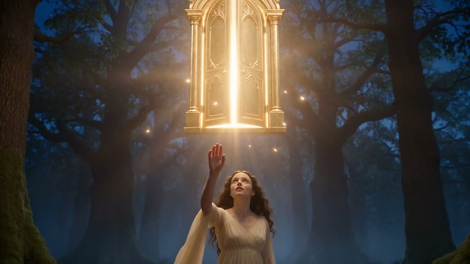

<!-- Generated by scripts/build_readme.py. Edit site.config.json, content/prompts.json, and generator scripts. -->

<a id="case-the-door-in-the-sky"></a>

# 天空之门（奇幻短片）

[← 返回合集](../../README.zh-CN.md)

**来源类型**: `community` · **任务**: `T2V` · **音画**: `Yes` · **状态**: `来源收录`

15 秒四段式魔幻写实短片时间轴：暮色迷雾森林中浮现空中金门并化作星光花海，配情绪管弦配乐。

<a href="https://raphael-assets.colorepistle.com/materials/f8df786e-2c54-4c4b-b8ed-14bdbdb1904e.mp4"></a>

▶ **[播放有声视频原片](https://raphael-assets.colorepistle.com/materials/f8df786e-2c54-4c4b-b8ed-14bdbdb1904e.mp4)**

**完整原始提示词**

```text
Create a breathtaking 15-second cinematic fantasy short film titled “THE DOOR IN THE SKY”. Aspect ratio16:9, one coherent protagonist and consistent appearance throughout, premium fantasy movie cinematography, photorealistic magical realism, atmospheric fog, volumetric lighting, elegant camera movement, emotional orchestral score, polished cinematic colour grading.

0–4 seconds: Wide establishing shot of a beautiful young woman in an elegant flowing ivory dress walking alone through a mysterious misty forest at twilight. Gentle wind moves her hair and dress.
4–8 seconds: Tiny golden lights begin appearing and circling her. The camera slowly pushes in as she notices an enormous glowing golden door floating above the trees.
8–12 seconds: She reaches upward; the door opens with a soft burst of brilliant golden light. Thousands of sparkling stars and luminous particles pour out into the night.
12–15 seconds: The forest transforms into a breathtaking galaxy garden with glowing flowers, floating stars and celestial light. She smiles in wonder as the camera pulls back to an epic wide shot. End on a magical cinematic reveal.
```

| 参数 | 配置 |
| --- | --- |
| 模型 | MAGI-2 (flagship) |
| 任务类型 | t2v |
| 时长 / 帧率 | 15.2s · 25 fps |
| 分辨率 / 比例 | 1080p · 16:9 |
| 音频模式 | music (audio=True) |

[原始来源](https://x.com/Naiknelofar788/status/2125650981350428965) · 作者: [@Naiknelofar788](https://x.com/Naiknelofar788) · 2026-11-25

> 作者标注通过 Higgsfield 使用 MAGI-2 生成；完整四段式提示词来自原帖。

**[在 Raphael 上生成同类视频 →](https://raphael.app/ai-video-generator?utm_source=github&utm_medium=repository&utm_campaign=magi_2_launch&utm_content=case_the-door-in-the-sky&utm_term=zh-CN)**
