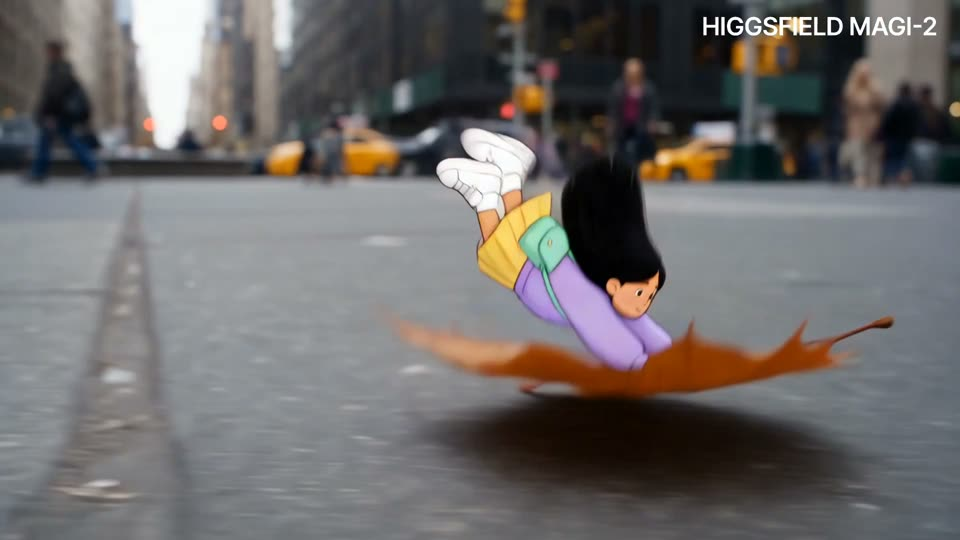

<!-- Generated by scripts/build_readme.py. Edit site.config.json, content/prompts.json, and generator scripts. -->

<a id="case-tiny-2d-girl-in-nyc"></a>

# Tiny 2D Anime Girl in Photoreal NYC

[← Back to collection](../../README.md)

**Origin**: `community` · **Task**: `T2V` · **Audio**: `Yes` · **Status**: `Source-linked`

6-scene mixed-media short blending a consistent hand-drawn 2D miniature character into live-action New York streets with synchronized urban SFX.

<a href="https://awesome.raphael.app/materials/a8d7cc8d-69ed-4500-8658-86e7c85b8182.mp4"></a>

▶ **[Watch audio-enabled MP4](https://awesome.raphael.app/materials/a8d7cc8d-69ed-4500-8658-86e7c85b8182.mp4)**

**Full Prompt**

```text
Create a whimsical mixed-reality animated short featuring a tiny hand-drawn 2D young woman with long black hair, an oversized lavender sweatshirt, a yellow pleated skirt, chunky white sneakers, and a small mint-green crossbody bag. She is only a few inches tall, navigating an enormous, ultra-photorealistic New York City environment.

SCENE SEQUENCE:

1. The Unexpected Journey: She emerges from a crack between giant sidewalk tiles and finds herself in the middle of a busy city plaza. A huge gust from a subway ventilation grate sends her flying backward, and she desperately grabs onto a loose leaf to avoid being swept away.

2. The Pigeon Encounter: She discovers a giant discarded pretzel near a park bench and tries to climb it. Suddenly, an enormous city pigeon lands beside her, shaking the ground with its wings. She hides inside the pretzel's central hole as the bird curiously pecks around her.

3. The Fountain Adventure: She reaches a gigantic public fountain. A sudden burst of water launches her onto a floating flower petal. She uses a tiny twig as a paddle, navigating between enormous splashing water jets before getting soaked by a final unexpected splash.

4. The Subway Escape: She finds an abandoned metro ticket near a station entrance and uses it as a makeshift skateboard. It slides down a sloping pavement, narrowly avoiding enormous shoes, rolling coins, and a dropped set of keys.

5. The Unexpected Flight: A passing cyclist creates a powerful wind tunnel. Her sweatshirt inflates like a balloon, lifting her above the pavement. She grabs onto a dangling ribbon attached to a giant shopping bag, swinging through the air like a miniature trapeze artist.

6. The Final Surprise: She lands safely inside the open top of an enormous takeaway coffee cup sitting on an outdoor café table. Relieved, she stretches out and celebrates her survival. Suddenly, a human hand picks up the cup. Her eyes widen as the cup begins moving toward someone's mouth. She desperately waves both arms, ending on a hilarious freeze-frame of pure disbelief.

VISUAL STYLE & PRODUCTION:

Premium mixed-media animation combining expressive, hand-drawn 2D character animation with highly realistic live-action city environments. Maintain a consistent character appearance, proportions, clothing, hairstyle, and hand-drawn outlines throughout.

Use exaggerated differences in scale, believable environmental interactions, playful physics, detailed macro photography, cinematic depth of field, dynamic tracking shots, smooth camera movements, and seamless compositing. The tiny character should feel genuinely present in the real world, casting subtle shadows and interacting naturally with objects.

AUDIO: No dialogue and no narration. Use immersive New York street ambience, distant traffic, subway rumbling, pigeon wings, fountain splashes, bicycle sounds, footsteps, café ambience, and perfectly timed whimsical comedic sound effects.

16:9 cinematic widescreen, fluid animation, crisp details, expressive character acting, vibrant but natural colors, polished commercial-quality finish. Every scene should introduce a new visual surprise, with a funny and memorable final punchline.
```

| Parameter | Value |
| --- | --- |
| Model | MAGI-2 (flagship) |
| Task type | t2v |
| Duration / FPS | 30.3s · 30 fps |
| Resolution / Ratio | 1080p · 16:9 |
| Audio mode | sfx (audio=True) |

[Original source](https://x.com/john_my07/status/2125654313825628182) · Creator: [@john_my07](https://x.com/john_my07) · 2026-11-25

> Creator reported Higgsfield collaboration; full prompt included in the original post.

**[Generate similar on Raphael →](https://raphael.app/ai-video-generator?utm_source=github&utm_medium=repository&utm_campaign=magi_2_launch&utm_content=case_tiny-2d-girl-in-nyc&utm_term=en)**
